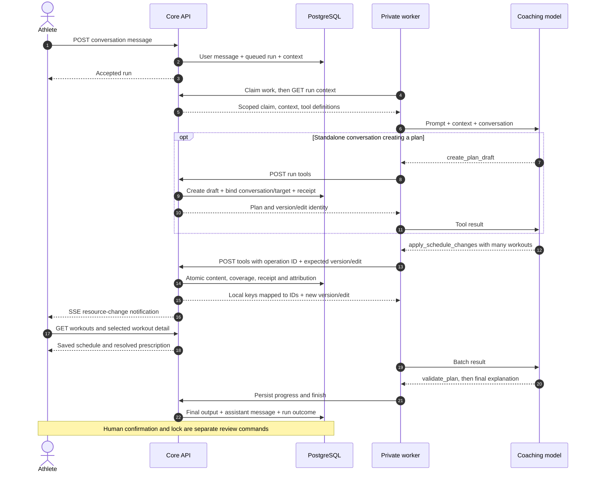
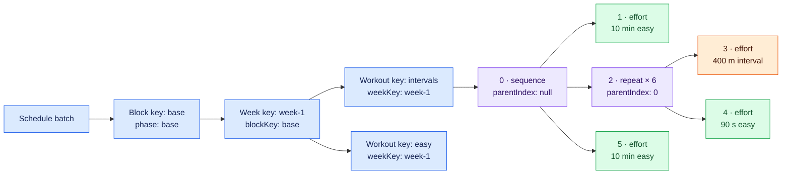
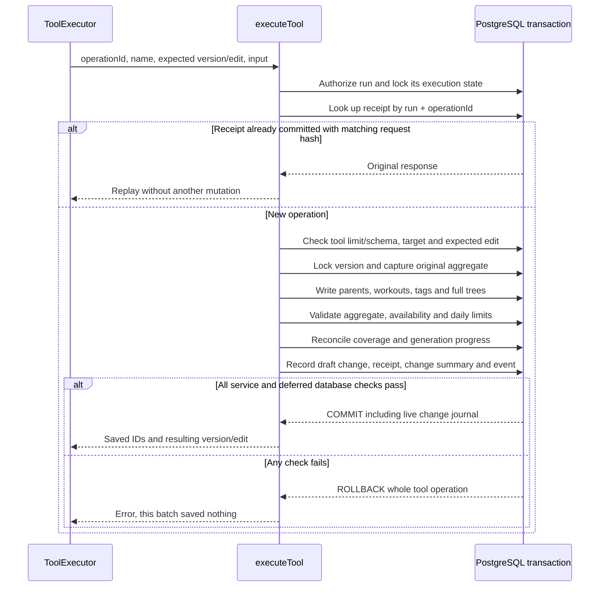

# How the coach creates workouts and batches a schedule

[Visual guide](./visual-guide.md) · [Database atlas](./database-map.md) · [Endpoint map](./endpoint-data-map.md)

The coach authors a structured prescription; the core API validates and commits it. A single workout and a set of workouts use the same schedule-batch tool. This walkthrough describes current behavior checked on 2026-10-14. Improvement options at the end are proposals.

## One turn, from message to visible workouts

The API accepts a user message and queues a durable run. A private worker claims it and asks the configured model to continue the conversation with structured context and tools. In a standalone conversation, clear creation intent permits `create_plan_draft`; otherwise the coach can discuss training without creating a plan. Before prescribing, it saves the brief/dates and records relevant fitness evidence or an explicitly justified estimate.



The sequence condenses heartbeat/progress traffic and intermediate model turns. Validation is another tool request before the final explanation. The database commits each accepted schedule tool independently; finishing the conversation is not a publication step.

## One workout is a full tree inside a batch

`apply_schedule_changes.input` contains `blocks`, `weeks`, `workouts`, deletion arrays, `generation` and `coverage`. These fields are required even when an array is empty or a range is null. To insert a single workout under an existing week, send one workout, use the existing week UUID as `weekKey`, and send empty block/week arrays. To create several workouts plus their parents, include them together and reference new parents with local keys.



In this example the step array's parent indices are `[null, 0, 0, 2, 2, 0]`. Every parent precedes its children; only sequence/repeat steps can be parents. The model supplies flat ordered steps, not nested database UUIDs. The API generates step UUIDs, converts `parentIndex` to `parent_step_id`, and calculates sibling positions. Repeat expansion is conceptual: six repetitions do not create six copies of each effort row.

Local `key` values must be unique across blocks, weeks and workouts in the batch. `blockKey`/`weekKey` resolves to a parent created in the same request or to an existing UUID owned by the same draft. The result's `ids` map returns persisted UUIDs for those keys; the envelope also returns `planId`, `versionId` and `editNumber`.

For the intervals workout, storage is one `workouts` row, six `workout_steps`, four `step_completions`, targets attached to the four efforts, and any tags. An `effort` completion ends by duration, distance, repetitions or open instruction; targets state the required intensity or action. The two containers have neither completions nor targets.

When editing an existing workout, pass its `id` and **the full intended workout**. The writer updates the workout header, deletes its old tags/steps (with completion/target cascades), then inserts the replacement tree. Unspecified steps are not preserved. The workout identity/lineage remains, while its rewritten descendant rows get new IDs. Read existing content with `read_schedule` before deciding what to replace.

### Concrete single-workout request

This illustrative tools request inserts a 30-minute easy run into an existing draft week. The run, version, edit and week IDs must come from real authorized context; the date must be within that week/plan and available in the brief. Its `easy` target needs running calibration to resolve. The root is an effort, so no sequence wrapper is needed. `coverage: null` deliberately makes no claim that this day's planning is finished.

```http
POST /internal/agent/runs/:runId/tools
Content-Type: application/json
```

```json
{
  "operationId": "example-easy-run-1",
  "name": "apply_schedule_changes",
  "expectedVersionId": "00000000-0000-4000-8000-000000000001",
  "expectedEditNumber": 3,
  "input": {
    "blocks": [],
    "weeks": [],
    "workouts": [
      {
        "key": "easy-monday",
        "weekKey": "00000000-0000-4000-8000-000000000002",
        "date": "2026-10-12",
        "position": 1,
        "discipline": "run",
        "title": "Easy aerobic run",
        "description": null,
        "purpose": "Build aerobic endurance",
        "priority": "low",
        "racePriority": null,
        "estimatedDurationSeconds": 1800,
        "estimatedDistanceMetres": null,
        "tags": ["easy"],
        "steps": [
          {
            "parentIndex": null,
            "kind": "effort",
            "repeatCount": null,
            "role": "main",
            "discipline": "run",
            "label": "Easy run",
            "instructions": null,
            "completion": {
              "type": "duration",
              "value": 1800,
              "unit": "seconds"
            },
            "targets": [{ "type": "zone", "key": "easy" }]
          }
        ]
      }
    ],
    "deleteWorkoutIds": [],
    "deleteWeekIds": [],
    "deleteBlockIds": [],
    "generation": { "startDate": "2026-10-12", "endDate": "2026-10-12" },
    "coverage": null
  }
}
```

To batch several workouts, add full workout objects to `workouts` and use the intended **whole** horizon for `generation`. The same POST commits them together. New parents can be added to the `blocks`/`weeks` arrays using local keys. To update rather than insert, additionally provide the existing workout's `id`. Use the returned `versionId`/`editNumber` for the next fresh operation; an HTTP retry must retain this original command unchanged.

## The transaction boundary



Receipt replay happens after run authorization and before fresh expected-edit checks. Reusing an operation ID with different command content causes `IDEMPOTENCY_CONFLICT`. The worker's HTTP retry reuses the same operation ID, input and expected edit; it does not ask the model to invent another command after uncertain delivery. Tools and finish deliveries permit up to three HTTP attempts for retryable failures. Tool replay still requires valid run authority/lease; receipts are not an unrestricted replay credential.

The service carries the committed edit number into the run and the worker's next request. If another writer changes the target, `STALE_CONTEXT` stops the run; `read_plan_context` cannot silently retarget it. Database triggers separately prevent locked-content writes and reject invalid local trees at commit. Invalid multi-workout input rolls back parents, workouts, coverage, generation intent, receipts and edit changes together.

**Atomicity is per tool call, not per entire coaching run.** If batch A commits and batch B fails, A remains saved. Cancellation, worker expiry and model failure also retain earlier accepted changes and durable output. The UI and final explanation must distinguish saved content from an unfinished horizon.

## Coverage and multiple batches

These three date concepts answer different questions:

| Field/storage                                     | Meaning                                                                                                                    |
| ------------------------------------------------- | -------------------------------------------------------------------------------------------------------------------------- |
| `plan_versions.start_date` / `end_date`           | Whole plan bounds. They may be longer than the schedule being generated now.                                               |
| Tool `generation`; persisted on `agent_runs`      | Full intended horizon for this run. Required on its first schedule batch; later batches repeat it exactly or use null.     |
| Tool `coverage`; rows in `plan_schedule_coverage` | Dates that are fully prescribed under the current brief, including deliberate rest days. Use null for an unfinished chunk. |
| `agent_runs.generation_prescribed_through`        | Contiguous, currently covered progress from this run's intended start. It does not jump over gaps.                         |

Example: a twelve-week plan can generate its first four weeks in two batches. The first batch declares the **four-week** generation horizon and coverage for the first two weeks. The second uses that same horizon or null and declares the next two weeks covered. A failed second batch leaves the first two weeks saved and a visibly unfinished four-week intent. A successful assistant reply alone cannot declare the horizon prescribed.

On the first batch, the writer removes previous coverage inside the intended horizon without automatically deleting its workouts. This prevents old coverage from making incomplete regeneration appear complete. Each mutation also invalidates coverage for affected old/new dates; an explicit coverage assertion then restores the completed range using the current brief hash. Changing or deleting a parent can invalidate its child dates too. Unrelated workouts remain unless the command explicitly changes/deletes them.

For `replace_schedule_range`, `range` is inclusive and controls workout deletion. Existing blocks/weeks remain, including parents spanning the boundary. Reuse their UUIDs as keys; do not pass existing parent `id` updates. New parents must fit inside the replacement range; replacement workouts must be new, inside it, and explicit deletion arrays must be empty. Replacement range and coverage must fit inside the run's intended horizon; coverage must also fit inside the replacement range.

The API can lock a coherent partial prescribed horizon following human brief confirmation and lock validation. It does not require every day through the whole plan end date to have been generated. The generation horizon must nevertheless be reported truthfully and its coverage handled explicitly.

## What batching means today

| Layer                  | Current behavior                                                                                                       | Consequence                                                                                                                                        |
| ---------------------- | ---------------------------------------------------------------------------------------------------------------------- | -------------------------------------------------------------------------------------------------------------------------------------------------- |
| Model tool arguments   | One schedule tool accepts many parents and full workouts                                                               | Already supports creating a set of workouts in one call.                                                                                           |
| Worker → API HTTP      | One tools POST per model tool; no generic multi-tool envelope                                                          | A schedule batch saves many workouts without one HTTP request per workout. Heartbeats/progress/reads remain separate traffic.                      |
| Tool concurrency       | OpenAI sets `parallelToolCalls: false`; Anthropic disables parallel tool use; shared `ToolExecutor` queues all calls   | Calls execute sequentially and each carries the previous result's edit. A provider response with multiple tools still executes them one at a time. |
| API transaction        | One transaction per accepted tool including content, receipt and attribution                                           | A bad workout makes the entire batch fail, rather than leaving a partial batch.                                                                    |
| SQL statement grouping | Writer loops over blocks, weeks, workouts, tags, steps, completions and targets, mostly awaiting individual statements | Atomic API batching does not yet imply bulk SQL insertion.                                                                                         |
| Multi-batch generation | Multiple committed transactions with durable intent/coverage                                                           | Can save coherent chunks incrementally; failure does not roll back previous chunks.                                                                |

### Enforced limits

| Boundary                                | Current maximum                                                                                                     |
| --------------------------------------- | ------------------------------------------------------------------------------------------------------------------- |
| Blocks/weeks/workouts per schedule tool | 20 blocks, 52 weeks, 100 workouts                                                                                   |
| Explicit deletion IDs                   | 20 blocks, 52 weeks, 100 workouts                                                                                   |
| Per-workout prescription                | 100 steps, 20 input tags, 5 input targets per step                                                                  |
| Aggregate steps in a batch              | 2,000                                                                                                               |
| Private request body                    | 1,000,000 bytes                                                                                                     |
| Serialized tool result                  | 500,000 JavaScript string characters                                                                                |
| Accepted fresh tool operations per run  | 200, including reads; receipt replay is excluded                                                                    |
| Model loop                              | `AGENT_MAX_TURNS`, default/max 40; adapter turn semantics differ, so this is not a guarantee of 40 schedule batches |
| Sessions per day                        | 2 across all sports; unavailable weekdays rejected                                                                  |

The input target limit is five; a missing symbolic zone can be added by the writer when an explicit pace/power target resolves to calibration. Effective batch size is also constrained by model output budget, the 20-second HTTP attempt timeout, run deadline and lease (90 seconds between renewals). The array maxima are not a promise that a maximum-sized batch will fit or be fast. `read_schedule` can hit the result limit; narrow its workout dates while remembering it still returns all blocks/weeks.

## Improvement options

These are proposals derived from the current code, **not measured bottlenecks or delivered changes**. Start with the existing timings in `agent_run_measurements`: `modelMs`, `toolMs`, `toolCalls`, `toolMsTotal`, `firstVisibleMs`, `firstDurableOutputMs`, `firstSavedBatchMs`, progress-write timings and `totalMs`. They distinguish model time, API tool time and user-visible progress, but do not yet count SQL statements or break down database work.

| Option                                                                | Why it may help                                                                                               | Tradeoff / evidence needed                                                                                                                                                                                       |
| --------------------------------------------------------------------- | ------------------------------------------------------------------------------------------------------------- | ---------------------------------------------------------------------------------------------------------------------------------------------------------------------------------------------------------------- |
| Tune coherent chunk size using existing schedule batching             | Fewer model/tool round trips while delivering useful saved chunks early                                       | Compare equal workout counts with different batch sizes, model time, first saved batch, total time, failures and incomplete coverage. Larger arguments can increase generation time and failure radius.          |
| Group SQL inserts for tags, steps, completions and targets            | Reduce row-level round trips inside a batch                                                                   | Preallocate IDs and sibling positions; insert in dependency-safe groups. Measure query count/transaction time before and after. Preserve deferred checks, cascades, receipt atomicity and full-tree replacement. |
| Reduce repeated aggregate reads/validation work                       | `executeTool` captures before state and computes attribution; `writeSchedule` rereads/validates the aggregate | Instrument stages first. Reuse transaction-consistent projections only if it preserves canonical comparison and whole-draft validation.                                                                          |
| Add a smaller, deliberate workout-edit operation if edits dominate    | Avoid resending/replacing every step for a small change                                                       | First measure edit frequency and argument/DB costs. A patch contract needs stable step identity, clear omission semantics and coverage invalidation; full replacement is currently easier to reason about.       |
| Consider a composed command for truly dependent setup operations      | Could combine brief/header plus schedule after understanding their cost                                       | Needs one defined atomic domain contract and expected-edit result. A generic list of arbitrary tools would complicate replay, error semantics and authorization.                                                 |
| Consider parallel read tools only after identifying a read bottleneck | May reduce independent read latency                                                                           | Current receipt bookkeeping/run locks and executor serialize even reads. Separate safe reads from writes explicitly; enabling provider parallelism alone will not provide end-to-end concurrency.                |

The first investigation should compare model time against tool time for representative single-workout edits and multi-week generation on both providers. If model time dominates, SQL grouping may barely affect total latency. If tool time grows with row count, instrument the writer's statements, aggregate reads, validation, change comparison and deferred triggers before selecting an optimization.

Do not parallelize schedule mutations by simply flipping provider flags: those tools share a draft/edit identity, affected coverage and parent references. Preserve optimistic concurrency, replay identity, whole-batch rollback, partial-run persistence, owner boundaries and the human lock boundary in any replacement design.

## Source and validation anchors

| Concern                                                     | Source / existing verification                                                                                                                                                                                                   |
| ----------------------------------------------------------- | -------------------------------------------------------------------------------------------------------------------------------------------------------------------------------------------------------------------------------- |
| Allowed fields and batch maxima                             | [Agent schemas](../../apps/api/src/modules/agent/agent.schemas.ts), [route body limit](../../apps/api/src/modules/agent/agent.routes.ts)                                                                                         |
| Parent resolution, tree replacement, coverage and SQL loops | [Schedule writer](../../apps/api/src/modules/agent/agent.schedule.ts)                                                                                                                                                            |
| Receipt replay, expected edit, authority and result size    | [executeTool and finishRun](../../apps/api/src/modules/agent/agent.service.ts)                                                                                                                                                   |
| Queued execution and HTTP retry                             | [ToolExecutor](../../apps/agent/src/runtime/core.ts), [AgentApi](../../apps/agent/src/api.ts)                                                                                                                                    |
| Provider tool behavior                                      | [OpenAI runtime](../../apps/agent/src/runtime/openai.ts), [Anthropic runtime](../../apps/agent/src/runtime/anthropic.ts)                                                                                                         |
| Generation intent and honest partial results                | [Coaching prompt](../../apps/agent/src/prompt.ts), [generation migration](../../database/migrations/20261002090000_schedule_generation.sql)                                                                                      |
| Saved output and measurements                               | [Progress reporter](../../apps/agent/src/progress.ts), [live service](../../apps/api/src/modules/live/live.service.ts)                                                                                                           |
| Behavioral tests                                            | [Database agent tests](../../apps/api/test/db/agent.test.ts): invalid multi-workout rollback, range preservation, receipt replay, cancellation retention, coverage gaps/regeneration, foreign references and race/cutback writes |
| Shared provider contract                                    | [Runtime contract tests](../../apps/agent/src/runtime/contract.test.ts): serialization, edit propagation, stale context, output durability and turn limits                                                                       |

The diagrams document these contracts; existing tests provide executable evidence. They do not establish production latency or an optimal batch size.
