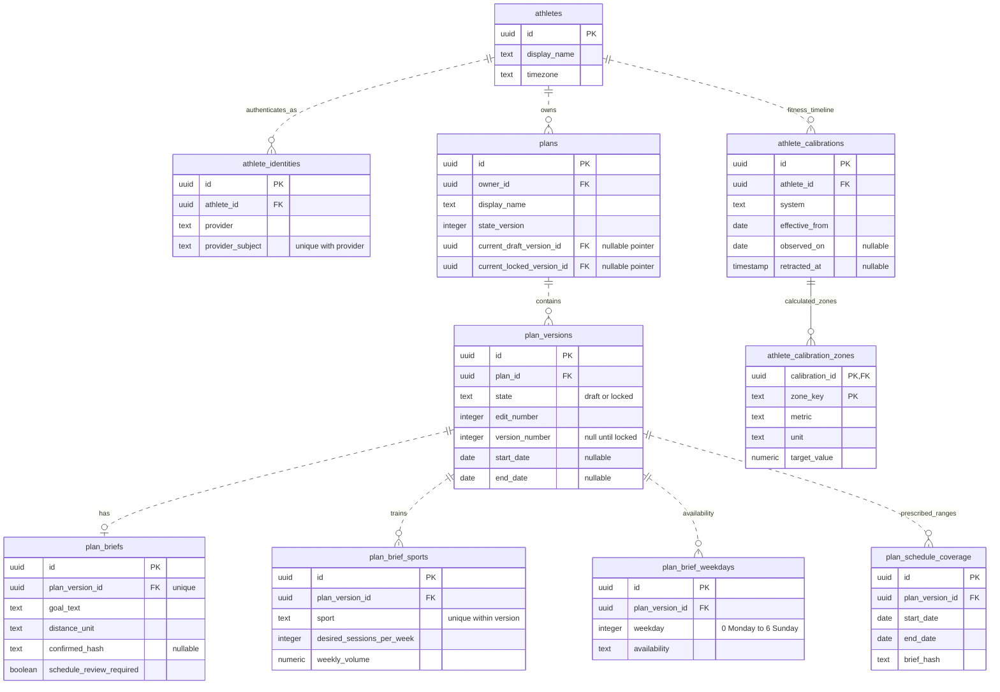
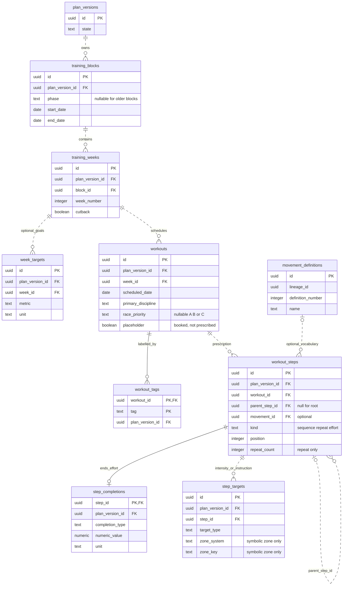
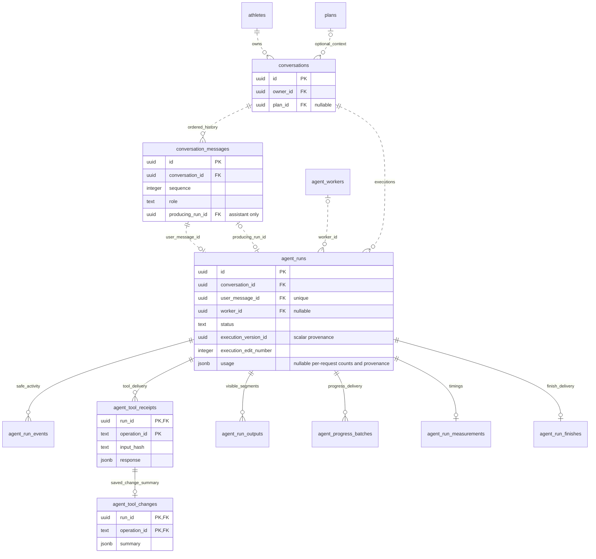

# Database relationship atlas

[Visual guide](./visual-guide.md) · [Endpoints](./endpoint-data-map.md) · [Workout generation](./agent-workout-flow.md)

PostgreSQL stores the athlete, versioned plan content, athlete fitness, conversations and execution history. The following views use current physical table names, checked on 2026-10-14. Every application table appears either in a diagram or the supporting-table inventory.

## Reading the diagrams

`||` means exactly one, `o|` means zero or one, and `o{` means zero or many. Read both ends: each plan has exactly one athlete, while an athlete can own zero or many plans. `PK` and `FK` mark primary and foreign key columns; multiple `PK` fields form a composite key. Dashed ER lines indicate non-identifying relationships; solid lines indicate relationships that contribute to the child's primary key. **Both are database relationships**, not a distinction between enforced and unenforced links. The labels identify the connection.

Only selected columns and relationships are drawn. Direct `plan_version_id` foreign keys repeated throughout the schedule tree are summarized in prose to avoid crossing lines. Nullable attributes are described in comments or prose; they are not inferred from a Mermaid type. For complete constraints, use [migrations](../../database/migrations/) and [current generated types](../../apps/api/src/database/generated.ts).

## 1. Athlete, plan versions and planning assumptions

The identity mapping translates a Clerk subject into an internal athlete UUID. Public operations derive ownership from authentication. The schema can hold multiple identities per athlete; there is no team membership or sharing table.

`plans` is mutable organizational metadata. Its current draft and current locked pointers reference versions **of the same plan**, enforced by composite foreign keys `(version_id, plan_id)`. Those extra pointer edges are omitted above. Version self-references `based_on_version_id` and `supersedes_version_id` also stay within the same plan: they distinguish where a draft came from and which locked version a new lock replaces.

Lock promotes a draft row in place. Unlock/restore copies the aggregate into a new draft. Version-owned content gets new physical UUIDs while preserving `lineage_id` for semantic comparison. Locked content is immutable; athlete calibration is outside that aggregate.

The brief's sport and weekday rows reference the **version**, not `plan_briefs.id`. The service supplies seven weekdays; a sport is unique within a version. Baseline fields distinguish unanswered, explicitly unknown and known. Run/swim volume is metres, cycle volume is seconds, and strength uses session counts.

Coverage is an inclusive date interval with the hash of its planning assumptions. It marks fully prescribed days, including rest days; absent workouts alone cannot tell a rest day from unfinished work. Overlapping ranges within a version are disallowed. See [coverage and generation](./agent-workout-flow.md#coverage-and-multiple-batches).

Each calibration entry belongs to an athlete and system (`run_pace`, `cycle_power`, `swim_pace`). It is retained with immutable calculated zones and can be retracted once. Optional `recorded_by_run_id` and `retracted_by_run_id` are foreign keys to `agent_runs` (omitted here). Strength has no calibration system. A version's `calibration_basis` is lock provenance in JSON, not a calibration ownership relationship.

## 2. Schedule and workout prescription tree

All schedule/prescription tables above, except the shared movement vocabulary, carry `plan_version_id`. Composite parent foreign keys stop a week, workout, tag, step, completion or target from being attached to content in another version. The step-parent key also includes `workout_id`, so a parent cannot be in a different workout. `movement_definitions.supersedes_definition_id` references an earlier definition in the same movement lineage (edge omitted).

The diagram shows structural FK cardinalities; deferred tree constraints further require **one root and at least one step per committed workout**. An effort has exactly one completion and no children. A sequence/repeat container has children and no completion or targets. Only repeats have `repeat_count`. A root may itself be an effort: a [placeholder session](../product/placeholder-sessions.md) is exactly one root effort with a duration completion and an RPE range target. A completion describes when a prescribed effort ends; it is **not a completed-workout log**.

Steps are ordered within their parent. Effort discipline inherits from a single-sport workout or is explicit; mixed workouts require an explicit discipline for each effort. Targets can be symbolic zones, absolute pace/power, RPE, reps in reserve, suggested load or instructions. Current agent tools use step labels for movements; they do not write `movement_id` or `week_targets`.

Symbolic targets have **no foreign key to a calibration zone**. Workout reads resolve `(athlete, system, workout date, zone key)` against the athlete's active timeline. They use the latest applicable entry, falling back to the first active entry for earlier dates. Recording fitness can therefore change resolved guidance for relevant dates across locked and draft plans without modifying their stored trees.

The derived views `workout_prescription_totals` and `weekly_plan_summary` are not tables. The first expands explicit prescription quantities through repeats; the second aggregates workout estimates. They do not record actual training or infer duration from a symbolic pace zone.

## 3. Conversation, execution and saved changes

Each run is caused by one user message; an assistant message is attributed to its producing run. The two message/run edges represent these distinct roles. Composite foreign keys keep the message and run in the same conversation and keep any plan-bound conversation under its owner. A run retains its initial `plan_id`/context; standalone creation binds the conversation and sets the separate execution target without rewriting that initial attribution.

`agent_runs.execution_plan_id`, `execution_version_id` and receipt `target_version_id` are scalar provenance rather than foreign keys to draft rows. That permits unpublished draft deletion while retaining conversation and tool history. Runtime checks enforce the current owner, plan, version, edit and lease. A worker can serve many runs over time, but each worker process has one active slot; active-run indexes also exclude concurrent runs for the same conversation/execution plan.

Tool receipts key `(run_id, operation_id)` and store the committed result. Change summaries refer to that exact receipt. Output items key `(run_id, item_id)`; progress deliveries key `(run_id, sequence)`; events key `(run_id, sequence)`. Finishes and measurements each key `run_id`. These are execution records, outside immutable plan content.

`agent_runs.usage` stores the worker's bounded per-request usage ledger. NULL
means not reported; unknown token fields are not zero-filled. Terminal rows allow
only the first usage attachment and NULL-to-known legacy token fills, with every
other column immutable. The API also checks the execution credential and bounds
late reporting to five minutes after the deadline.

## Supporting tables and links

| Table                                           | Keys and relationships                                                          | Purpose                                                                                                                  |
| ----------------------------------------------- | ------------------------------------------------------------------------------- | ------------------------------------------------------------------------------------------------------------------------ |
| `api_idempotency_keys`                          | UUID PK; `athlete_id` FK; unique athlete + command scope + key                  | Replay public commands with their original response; separate from run tool receipts.                                    |
| `live_event_heads`                              | `owner_id` PK/FK to `athletes`                                                  | Allocate the owner's committed live cursor.                                                                              |
| `live_events`                                   | `(owner_id, sequence)` PK; owner FK to `athletes`                               | Notifications with type, resource ID and bounded metadata. `resource_id` is a typed event reference, not a universal FK. |
| `example_plan_editions`                         | `(owner_id, blueprint_revision, anchor_date)` PK; owner FK; unique `plan_id` FK | Operator provenance for published example plans.                                                                         |
| `seed_runs`                                     | `seed_key` PK; no domain FK                                                     | Development seed bookkeeping.                                                                                            |
| `atlas_schema_revisions.atlas_schema_revisions` | Managed by Atlas in its own schema                                              | Migration application history, not an application entity.                                                                |

Live rows are a notification journal. The application refetches authorized projections after notifications or cursor resets; durable plan/chat/output data is authoritative after reload and journal pruning.

Removed historical entities such as `plan_goals`, `plan_constraints`, `calibration_profiles`, `calibration_zones` and `plan_calibration_periods` should not be reintroduced when reading the initial migration. Follow the full ordered migration history.
