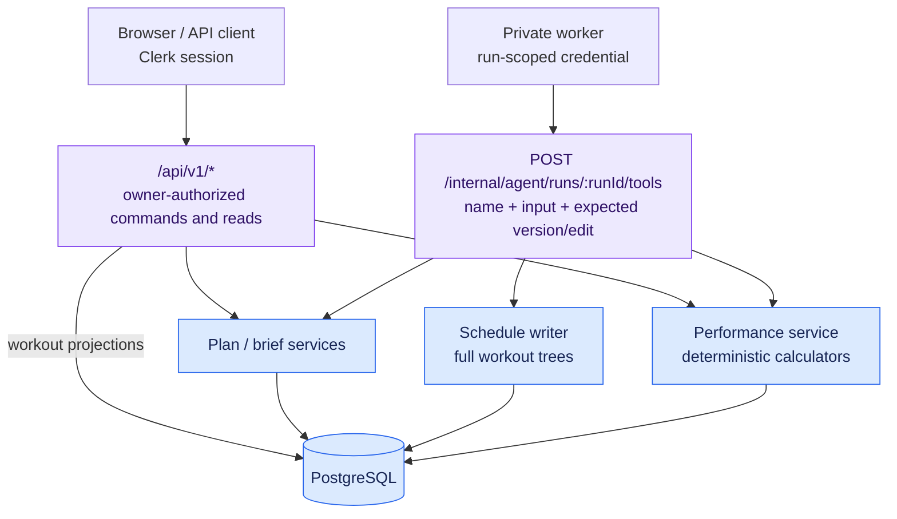

# Endpoint and data map

[Visual guide](./visual-guide.md) · [Database atlas](./database-map.md) · [Workout generation](./agent-workout-flow.md)

Checked against public OpenAPI, route handlers and services on 2026-10-14. Paths below use `:parameter` notation; OpenAPI uses `{parameter}`. Tables list principal domain reads/writes, not every authorization query, receipt or trigger side effect.

## Two API surfaces

The browser uses `/api/v1/*` with Clerk authorization; the API derives its internal athlete identity. The private worker uses `/internal/agent/*` with machine credentials. It has no database credentials and performs domain writes through the core API.

The model's `apply_schedule_changes` is a **tool name inside a request body**, not an HTTP route. Every model tool goes through the same `POST /internal/agent/runs/:runId/tools` endpoint, carrying an operation ID and the run's expected version/edit. There is no public `POST /api/v1/workouts` or generic endpoint accepting a list of unrelated HTTP calls.

## Public plan, brief and workout routes

| Endpoint(s)                                                                                          | Principal data                                                                  | Behavior                                                                                                                          |
| ---------------------------------------------------------------------------------------------------- | ------------------------------------------------------------------------------- | --------------------------------------------------------------------------------------------------------------------------------- |
| `GET /api/v1/plans`, `GET /api/v1/plans/:planId`                                                     | `plans`, selected `plan_versions`, derived counts                               | List/detail of owned logical plans and version metadata.                                                                          |
| `POST /api/v1/plans`                                                                                 | Write `plans`, initial `plan_versions`; optionally `conversations`              | Create logical plan and draft atomically.                                                                                         |
| `PATCH /api/v1/plans/:planId`; `POST .../activate`, `.../deactivate`, `.../archive`, `.../unarchive` | `plans`                                                                         | Rename and organization state. Activation requires locked content; plan archive makes associated chats unavailable for execution. |
| `GET /api/v1/plans/:planId/draft`; `GET .../revisions`; `GET .../revisions/:revisionId`              | `plan_versions`; detail reads version aggregate                                 | Read draft, immutable history list or revision detail.                                                                            |
| `PATCH /api/v1/plans/:planId/draft`                                                                  | `plan_versions`, brief review/confirmation state, coverage reconciliation       | Edit dates/description with draft/edit identity.                                                                                  |
| `GET /api/v1/plans/:planId/draft/brief`; `GET .../revisions/:revisionId/brief`                       | `plan_briefs`, sports, weekdays, coverage, version header                       | Read assumptions, confirmation and prescribed horizon.                                                                            |
| `PUT /api/v1/plans/:planId/draft/brief`                                                              | Brief/sports/weekdays and version header                                        | Save planning assumptions; relevant changes invalidate confirmation or schedule review.                                           |
| `POST /api/v1/plans/:planId/draft/brief/validate`                                                    | Brief and coverage state                                                        | Read validation state; does not confirm.                                                                                          |
| `POST /api/v1/plans/:planId/draft/brief/confirm`                                                     | Confirmation fields in `plan_briefs`                                            | Human confirms the reviewed brief hash and warnings.                                                                              |
| `POST /api/v1/plans/:planId/validate`                                                                | Version aggregate and athlete calibrations                                      | Compute lock findings, hashes and validation digest.                                                                              |
| `POST /api/v1/plans/:planId/lock`                                                                    | `plans`, `plan_versions`; optional brief confirmation                           | Promote draft in place, record lock evidence/calibration basis, move pointers. Human command.                                     |
| `POST /api/v1/plans/:planId/unlock`                                                                  | New `plan_versions` and cloned version-owned descendants; `plans` pointers      | Copy current lock into an editable draft, preserving lineage.                                                                     |
| `POST /api/v1/plans/:planId/revisions/:revisionId/restore-preview`; `POST .../restore`               | Read historical aggregate; restore writes cloned draft/descendants and pointers | Preview, then copy supported historical content; existing locked history stays.                                                   |
| `POST /api/v1/plans/:planId/discard`                                                                 | Delete unpublished draft and descendants; `plans` pointer                       | Initial draft cannot be discarded; retained execution attribution survives.                                                       |
| `GET /api/v1/blocks?planVersionId=:versionId`                                                        | `training_blocks`, `training_weeks`                                             | Block/week structure, phases and cutback flags for an owned version.                                                              |
| `GET /api/v1/workouts?planVersionId=:versionId`                                                      | `workouts`, week/version/owner joins                                            | Workout summaries for an explicit version.                                                                                        |
| `GET /api/v1/workouts/:workoutId`                                                                    | Workout, tags, steps, completions, targets, movements and athlete calibration   | Full prescription with resolved zone guidance.                                                                                    |

Here `.../activate`, for example, expands to `/api/v1/plans/:planId/activate`. Brief and lifecycle writes also consult ownership, concurrency and run state. Selected public commands use `api_idempotency_keys`; their header/body key requirements are in the [public schemas](../../packages/api-client/openapi.json). They differ from run-scoped tool receipts.

## Public performance, conversation and delivery routes

| Endpoint(s)                                                                                                                                                                              | Principal data                                            | Behavior                                                                         |
| ---------------------------------------------------------------------------------------------------------------------------------------------------------------------------------------- | --------------------------------------------------------- | -------------------------------------------------------------------------------- |
| `GET /api/v1/performance`                                                                                                                                                                | `athlete_calibrations`, zones, plans using each system    | Athlete's current fitness and timeline, independently of a plan.                 |
| `POST /api/v1/performance/calibrations/preview`                                                                                                                                          | Current calibration read + calculator                     | Calculate candidate zones; no saved calibration.                                 |
| `POST /api/v1/performance/calibrations`; `POST .../calibrations/:calibrationId/retract`                                                                                                  | Append calibration + zones, or mark one retraction        | Changes resolved guidance across the athlete's plans without rewriting workouts. |
| `GET /api/v1/chat-capabilities`                                                                                                                                                          | Worker readiness/configuration                            | Whether fresh coaching submissions are available.                                |
| `GET /api/v1/conversations`; `POST /api/v1/conversations`; `GET /api/v1/conversations/:conversationId`; `PATCH .../:conversationId`; `POST .../:conversationId/archive`, `.../unarchive` | `conversations`, ownership/plan joins                     | Conversation list/create/detail/title/archive state.                             |
| `POST /api/v1/plans/:planId/conversations/open`                                                                                                                                          | Owned `plans`, `conversations`                            | Open/create conversation associated with a plan.                                 |
| `GET /api/v1/conversations/:conversationId/messages`                                                                                                                                     | `conversation_messages`, related runs                     | Durable ordered conversation history.                                            |
| `POST /api/v1/conversations/:conversationId/messages`                                                                                                                                    | Write user message, queued `agent_runs`, run event        | Accept a coaching turn and snapshot its target/context.                          |
| `GET /api/v1/agent-runs/:runId`; `POST .../:runId/cancel`; `GET .../:runId/events`                                                                                                       | `agent_runs`, `agent_run_events`                          | Run state, cancellation request and safe activity history.                       |
| `GET /api/v1/conversations/:conversationId/runs`; `GET /api/v1/agent-runs/:runId/turn`                                                                                                   | Runs, messages, receipts/change summaries, output/timings | Turn projections, generation progress and saved-change attribution.              |
| `GET /api/v1/agent-runs/:runId/output`                                                                                                                                                   | `agent_run_outputs`                                       | Durable visible segments, including partial output.                              |
| `GET /api/v1/plans/:planId/draft/changes`                                                                                                                                                | Draft/locked aggregates and saved run changes             | Current draft differences and coaching attribution.                              |
| `GET /api/v1/live/bootstrap`; `GET /api/v1/live/events`                                                                                                                                  | `live_event_heads`, `live_events`                         | Cursor bootstrap and owner-scoped SSE change notifications.                      |

Live events carry resource identifiers, not authoritative workout content. The browser follows a notification with ordinary owner-authorized reads. That same durable data supports reload; SSE is not a second workout store.

## Private worker lifecycle

These routes are registered with Hono directly and are **not included in public OpenAPI**. The boundary is in [agent.routes.ts](../../apps/api/src/modules/agent/agent.routes.ts); the worker HTTP client is [api.ts](../../apps/agent/src/api.ts).

| Endpoint                                     | Credential | Principal reads/writes                                                                                                 |
| -------------------------------------------- | ---------- | ---------------------------------------------------------------------------------------------------------------------- |
| `POST /internal/agent/register`              | Bootstrap  | Upsert worker profile/readiness in `agent_workers`.                                                                    |
| `POST /internal/agent/claim`                 | Bootstrap  | Claim queued `agent_runs`, assign worker, lease and run credential digest; record started event.                       |
| `GET /internal/agent/runs/:runId/context`    | Run-scoped | Conversation history, plan/brief/performance context and API-defined tool schemas.                                     |
| `POST /internal/agent/runs/:runId/heartbeat` | Run-scoped | Renew lease or observe cancellation/run state.                                                                         |
| `POST /internal/agent/runs/:runId/tools`     | Run-scoped | Dispatch one named tool; commit result/receipt/change attribution and related live journal entries with domain writes. |
| `POST /internal/agent/runs/:runId/progress`  | Run-scoped | Save output segments, safe tool activity, progress sequence receipts and timings.                                      |
| `POST /internal/agent/runs/:runId/finish`    | Run-scoped | Finish receipt, run outcome/usage, final output marker and assistant message on successful completion.                 |

Bootstrap credentials register/claim work; a claimed run's scoped credential is used for its execution. Lease, deadline, cancellation and owner/target checks apply on the API, rather than trusting the model's arguments.

## Model tools and entity interaction

All eleven tools below share the tools endpoint. Availability comes from the API's [tool definitions](../../apps/api/src/modules/agent/agent.schemas.ts); dispatch is implemented in [executeTool](../../apps/api/src/modules/agent/agent.service.ts).

| Tool name                | Domain interaction                                                                                                   | Batch behavior                                                                                                                |
| ------------------------ | -------------------------------------------------------------------------------------------------------------------- | ----------------------------------------------------------------------------------------------------------------------------- |
| `read_plan_context`      | Current logical plan, selected version, brief and coverage                                                           | Context projection, not a mutation or stale-target retargeting mechanism.                                                     |
| `read_schedule`          | Blocks, weeks, workouts, steps, completions, targets, tags                                                           | Reads all structural parents; optional inclusive dates filter workouts and their descendants. Returns physical IDs for edits. |
| `create_plan_draft`      | Create plan/draft; bind standalone conversation and execution target                                                 | One plan per bound conversation. Never locks.                                                                                 |
| `update_plan_brief`      | Save brief, sports, weekdays, header and review state                                                                | A complete brief input, not arbitrary row patches.                                                                            |
| `read_performance`       | Athlete calibration timeline and usage                                                                               | Works in standalone discussion.                                                                                               |
| `preview_performance`    | Calculate candidate zones alongside current fitness                                                                  | No calibration write.                                                                                                         |
| `record_performance`     | Append calibration/zones attributed to run                                                                           | One result or estimate; not a schedule revision.                                                                              |
| `retract_performance`    | Mark one calibration retraction attributed to run                                                                    | One entry.                                                                                                                    |
| `apply_schedule_changes` | Add/update/delete blocks, weeks, full workouts/trees; reconcile coverage and generation progress                     | **One atomic multi-entity batch**; existing workouts are replaced in full at the tree/tag level.                              |
| `replace_schedule_range` | Delete workouts in explicit inclusive range, then add replacement workouts; retain existing parents/outside workouts | **One atomic range batch**; existing parent IDs can be reused, but existing parents cannot be edited through this tool.       |
| `validate_plan`          | Draft aggregate, coverage, brief, calibration and lock findings                                                      | Review result only; no confirmation or publication.                                                                           |

Every successfully executed tool, including reads, consumes one of the run's 200 tool slots and records a receipt; replaying the same accepted operation consumes no additional slot. Mutating plan tools additionally record saved-change summaries. The worker/model cannot confirm, lock, unlock, restore, discard, activate or archive a plan through its tool allowlist.
