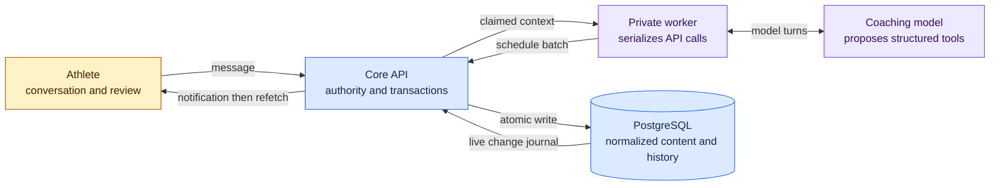

# Database and coaching flow: visual guide

This guide traces a workout from the coach's tool call to its relational rows and back to the application. It describes the implementation checked on 2026-10-14, including both coaching providers and migrations through `20261013120000_agent_provider_anthropic.sql`.

## Start here

| Question                                                   | Read                                                               |
| ---------------------------------------------------------- | ------------------------------------------------------------------ |
| What is stored, and how do the entities connect?           | [Database relationship atlas](./database-map.md)                   |
| Which endpoints read or write those entities?              | [Endpoint and data map](./endpoint-data-map.md)                    |
| How does the agent create one workout or a whole schedule? | [Workout generation and batching](./agent-workout-flow.md)         |
| What could we improve, and how would we decide?            | [Improvement options](./agent-workout-flow.md#improvement-options) |

The key distinction: **a schedule tool call already batches many workouts into one API request and one transaction**. Separate tool calls execute sequentially. Inside the transaction, the current writer mostly issues individual SQL statements for rows. Those are three different places to consider batching.

## Diagramming proposal

Use Mermaid fenced blocks as the source of truth. [GitHub renders them in Markdown](https://docs.github.com/en/get-started/writing-on-github/working-with-advanced-formatting/creating-diagrams), so reviewers can read the diagrams beside the explanation and review changes as text. No exported images, paid editor or new application dependency is needed. [Mermaid's ER notation](https://mermaid.js.org/syntax/entityRelationshipDiagram.html) supplies cardinalities and key annotations.

Use focused views rather than one enormous graph: ownership/versioning, workout prescriptions, and coaching execution. The ER diagrams use actual table and column names; flow and sequence diagrams explain behavior. Attributes are selected for navigation, not a substitute for the full SQL definitions. The prose and tables provide a text alternative to every diagram.

## Authority and maintenance

Read current source alongside the diagrams:

- [Ordered migrations](../../database/migrations/) define foreign keys, checks and triggers. Older migrations can name tables later removed or renamed.
- [Generated database types](../../apps/api/src/database/generated.ts) list current tables, views and columns; they do not describe all constraints. SQL `date` fields appear as `Timestamp` in these generated types, but API calendar dates remain `YYYY-MM-DD` strings.
- [Public OpenAPI](../../packages/api-client/openapi.json) describes browser/client endpoints. Internal worker endpoints are registered separately in [agent routes](../../apps/api/src/modules/agent/agent.routes.ts).
- [Agent schemas](../../apps/api/src/modules/agent/agent.schemas.ts), [tool service](../../apps/api/src/modules/agent/agent.service.ts) and [schedule writer](../../apps/api/src/modules/agent/agent.schedule.ts) define allowed tool inputs and committed behavior.

When changing a table relationship, update the relevant atlas view. When adding a route or tool, update the endpoint map. When changing transaction, coverage, retry or concurrency behavior, update the generation walkthrough and its limits. Keep proposed improvements labelled as proposals until implemented.

Existing [domain concepts](./data-model.md), [storage guidance](./storage-architecture.md), [plan lifecycle contract](./phase-2-schema-contract.md) and [brief/performance contract](./phase-3-schema-contract.md) provide deeper context. For exact current schema/hash versions or restore eligibility, follow the executable sources rather than an older document checkpoint.
