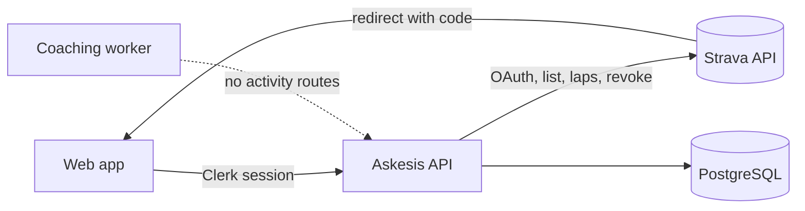

# Activity integration and plan adherence

**Status:** Proposal, with a working MVP for Strava (this branch). **Written:** 2026-10-14. **Tracks:** [#54](https://github.com/benjamingriff/askesis/issues/54); complements manual completion in [#45](https://github.com/benjamingriff/askesis/issues/45).

Askesis knows what an athlete _planned_. This proposal brings in what they _did_, from the platforms where workouts are already recorded, and compares the two: what was completed, partly done, moved or missed; whether each rep of a structured session was done and on target; and whether the athlete is ahead of or behind plan. Strava is the first provider because most activities end up there.

## 1. What Strava allows, and what that changes

Strava's [API Policy](https://www.strava.com/legal/api_policy), effective 1 June 2026, and its [API Agreement](https://www.strava.com/legal/api) shape the design more than any technical detail. Read on 2026-10-14; this is a product reading, not legal advice.

| Clause                                                                                                                                                                         | Consequence for Askesis                                                                                                                                                                                                                                                                                                   |
| ------------------------------------------------------------------------------------------------------------------------------------------------------------------------------ | ------------------------------------------------------------------------------------------------------------------------------------------------------------------------------------------------------------------------------------------------------------------------------------------------------------------------- |
| §5.3: no use "in connection with the development, training, evaluation, or operation of any AI Application", including derived data and "ingestion into a context window"      | **The coach must never see Strava data, or anything derived from it**, including matched completed/missed statuses. The MVP keeps activity data out of every `/internal/agent` route and the prompt. The coach's view of "what happened" must come from data the athlete gives Askesis directly (manual completion, #45). |
| §6.2: "You may not retain Strava Data in your cache for longer than seven (7) days"; §6.4 retention only as long as needed                                                     | Activities are a **rolling seven-day cache**: every sync re-reads the plan window and refreshes each row; rows not refreshed for seven days are purged hourly. Only the athlete's own link/reject decisions persist beyond that.                                                                                          |
| §6.3: stop showing data the user deleted on Strava                                                                                                                             | Each sync deletes activities in the window that Strava no longer lists. Webhooks (phase 2) make this near-immediate.                                                                                                                                                                                                      |
| §7.4: delete within 30 days of revocation or a deletion request                                                                                                                | Disconnecting revokes access and deletes the connection, activities, laps and decisions immediately, by cascade.                                                                                                                                                                                                          |
| §2.3, §6.1: show a user's data only to that user                                                                                                                               | Activities are owner-scoped like plans. No sharing surfaces.                                                                                                                                                                                                                                                              |
| [Getting started](https://developers.strava.com/docs/getting-started/): "A Strava subscription is a prerequisite for creating an app"; new apps are single-player (capacity 1) | The owner can test with their own account today. Friends-and-family needs the Standard tier (10 athletes); more needs Strava's review.                                                                                                                                                                                    |
| [Rate limits](https://developers.strava.com/docs/rate-limits/): reads 100 per 15 minutes and 1,000 per day, per app                                                            | Activity lists cost one request per 100 activities; laps cost one per activity. Syncs fetch laps only for sessions that can use them, and stop at 80% of the 15-minute budget.                                                                                                                                            |
| [Brand guidelines](https://developers.strava.com/guidelines/): official "Connect with Strava" button; "View on Strava" links in bold, underline or #FC5200                     | The MVP uses "View on Strava" links in Strava orange. The connect button is styled text; production must swap in the official asset.                                                                                                                                                                                      |
| [Authentication](https://developers.strava.com/docs/authentication/): refresh tokens rotate; `oauth/revoke` replaces `oauth/deauthorize` by 1 June 2027                        | Every refresh stores the new refresh token. Disconnect uses `oauth/revoke`.                                                                                                                                                                                                                                               |

**Recommendation.** Strava is a good way to prove the experience and the matching logic with real data. It is a poor foundation for the coaching loop, because the coach can never read it. Before a wider release, add a provider whose data Askesis may use for coaching: direct FIT/TCX/GPX upload (the athlete's own files, including Strava's bulk export), then Garmin Connect or Apple Health. Ask a lawyer to review the Strava terms before inviting anyone else.

## 2. How the integration runs

- **OAuth through the web app.** "Connect with Strava" asks the API for an authorization URL. The API signs a `state` that binds the athlete and expires in ten minutes (HMAC). Strava redirects to `/connections/strava/callback` on the web origin. That page posts `code` and `state` back with the athlete's Clerk session, so the callback never needs an unauthenticated API route. The API checks the state, exchanges the code and refuses a grant without activity scope (and revokes it).
- **Credentials stay in the API.** Access and refresh tokens are encrypted with AES-256-GCM before storage, under a key derived from `INTEGRATION_ENCRYPTION_KEY`. Strava error bodies are never logged or forwarded. A Strava account can belong to only one Askesis athlete.
- **Syncs are leased.** A sync claims its connection row for up to two minutes, so two tabs cannot refresh the rotating token concurrently. "Sync now" runs one; the app also syncs quietly when opened if the last sync is more than 30 minutes old.
- **Cache expiry runs hourly** in the API process, even for athletes who stop opening the app.

Phase 2 adds the [webhook](https://developers.strava.com/docs/webhooks/) receiver: one subscription per app, a two-second acknowledgement, and up to three retries. Create/update/delete events would be queued in PostgreSQL and processed by the existing sweeper pattern, so an activity appears within seconds of upload and deletions and deauthorizations apply at once. A public HTTPS callback URL is needed, so this can't be tested on localhost.

## 3. Ingestion

1. **Window.** From a week before the earliest active plan's start date (capped at six months), or the last four weeks with no active plan, through tomorrow.
2. **List.** `GET /athlete/activities?after&before`, up to 10 pages of 100. Each activity is upserted by `(connection, Strava id)` and its `fetched_at` refreshed. Activities in the window that Strava no longer returns are deleted.
3. **Laps.** `GET /activities/{id}/laps` only for runs, rides and swims within three days of a structured workout (one with repeats) in an active plan. Missing laps come first, then the stalest. At most 30 per sync, stopping when the read budget passes 80%.
4. **Purge.** Activities and laps older than the seven-day cache are deleted.

Not fetched: streams (heart rate, GPS, power by second), segments, photos, routes and kudos.

## 4. Storage and format

Migration [`20261013120000_activity_ingestion.sql`](../../database/migrations/20261013120000_activity_ingestion.sql):

| Table                      | Holds                                                                                                                                                                                                                                                                                                                                                                                    |
| -------------------------- | ---------------------------------------------------------------------------------------------------------------------------------------------------------------------------------------------------------------------------------------------------------------------------------------------------------------------------------------------------------------------------------------- |
| `integration_connections`  | One per athlete and provider: provider athlete id, display name, granted scopes, encrypted tokens and expiry, status (`active`, `reauthorization_required`), last sync and error code, sync lease.                                                                                                                                                                                       |
| `activities`               | Normalized summaries: `sport` (`run`, `cycle`, `swim`, `strength`, `row`, `other`), the provider's `source_sport_type`, name, `started_at` (instant) and `local_date` (the day where it happened, from `start_date_local`), elapsed and moving seconds, distance and elevation in metres, average speed (m/s) and power (W), trainer/manual/race flags, `fetched_at`, `laps_fetched_at`. |
| `activity_laps`            | Per lap: elapsed and moving seconds, metres, m/s and W.                                                                                                                                                                                                                                                                                                                                  |
| `activity_match_overrides` | The athlete's decisions: `link` or `reject` for (plan, **workout lineage**, connection, **provider activity id**).                                                                                                                                                                                                                                                                       |

Format choices:

- **Canonical units:** metres, seconds, metres per second and watts, like the plan model. Display units follow the athlete's settings.
- **Calendar day, not instant, for matching.** A 23:30 run in Sydney belongs to that Sydney day, wherever the server runs.
- **No raw payloads.** No JSON blobs of Strava responses, routes, polylines or heart rate. This is less to protect and less to delete, and it keeps the cache honest.
- **Decisions outlive the cache.** They are keyed by stable identifiers (workout lineage survives unlock/edit/relock; Strava ids survive purges and re-syncs), so a link the athlete made applies again when the activity is next fetched.
- **Provider-neutral activity rows.** A FIT upload or Garmin connection would add a source value. Matching and the UI need no change.

## 5. From activities to the dashboard

Matching is **computed on every read** by a pure function, [`reconcile()`](../../apps/api/src/modules/activities/activity.matching.ts). Its inputs are the version's workouts and weeks, the athlete's activities around the plan dates, their decisions and today in their timezone. Nothing stored can drift out of date when the coach edits a draft, a plan is relocked or a sync changes an activity.

**Per workout** (`GET /api/v1/adherence?planVersionId=`):

| Status      | Meaning                                                                                                                                                                                                                     |
| ----------- | --------------------------------------------------------------------------------------------------------------------------------------------------------------------------------------------------------------------------- |
| `completed` | Linked, and actual volume is at least 85% of planned: distance when both sides have one, otherwise time (moving time for endurance, elapsed for gym work). A workout with no planned volume counts as complete once linked. |
| `partial`   | Linked, but below 85%, or a brick with only one of its sports.                                                                                                                                                              |
| `missed`    | Not linked and the date has passed.                                                                                                                                                                                         |
| `planned`   | Not linked, today or later.                                                                                                                                                                                                 |

Each outcome also carries `dayOffset` (negative = done early, positive = late), `matchedBy` (`auto` or `manual`) and actual seconds and metres.

**Extra activities** are those in the plan dates that no workout claimed. They count toward actual volume when their sport is one the plan trains (an extra run in a triathlon plan does; a walk doesn't).

**Per week:** planned volume, **due** volume (workouts dated before today plus any already done early), **actual** volume (linked activities in their workout's week plus counting extras), and completed, partial, missed and extra counts. **Ahead or behind** is actual minus due. Within 5% (at least 10 minutes or 500 m) is "on track". Doing Thursday's long run on Tuesday makes the athlete ahead until Thursday, and missed sessions put them behind.

The web app shows:

- **Today:** a status line on the hero card ("Done · 28 km · 1h 04"), rings for done days and hollow dots for missed ones on the week strip, and a "This week" card of done versus planned with sessions and an ahead/behind line, as in the mobile prototype.
- **Plan schedule:** outcome chips on workout cards ("Done", "Done a day late", "Partial", "Missed") and a Done stat per week.
- **Workout dialog:** a "What you did" section with the activity's numbers, percentage of plan, "View on Strava", rep-by-rep checks, "Not this session" and "Link a different activity".
- **Settings › Connections:** connect, sync now, last sync, activity count, reconnect and disconnect.

## 6. Linking: which activity belongs to which workout?

> Do we link within days, or allow a ±7-day grace period?

Both, at different levels of trust:

| Gap              | Automatic?                                     | Why                                                                                                               |
| ---------------- | ---------------------------------------------- | ----------------------------------------------------------------------------------------------------------------- |
| Same day         | Yes, preferred                                 | The overwhelming case.                                                                                            |
| ±1 day           | Yes, if the volume is plausible (within ~2.5×) | Swapping adjacent days is common; a 10-minute jog the next day is not the long run.                               |
| ±2–3 days        | Yes, only inside the same training week        | Rearranging within a week is still following the plan. Crossing a week boundary would quietly hide a missed week. |
| ±4–7 days        | Only when the athlete links it                 | Possible ("I did Saturday's long run on Wednesday") but ambiguous enough that a human should say so.              |
| More than 7 days | Never                                          | That is a different session; the coach should rearrange the plan instead.                                         |

A pairing's score is 65% date proximity (1, 0.55, 0.3, 0.15 for 0–3 days) and 35% volume similarity (1 at equal volume, falling to 0 at three times more or less). Pairs are assigned best-first, so each activity fills at most one workout, and a same-day match beats a moved one. Sports must be compatible: runs (including trail and virtual) fill runs, rides fill rides (e-bikes don't), swims fill swims, weight training and HIIT fill strength. A **brick** has a slot per sport, so a ride and a run both count and one alone is partial. A gym-style mixed session takes strength or rowing.

## 7. Flagging: making sure the right workout is tagged

Automatic matching handles most weeks. Where it can't be sure, the athlete corrects it, and corrections stick:

- **"Not this session"** records a rejection. That pairing is never suggested again, and the activity may then match elsewhere or become extra.
- **"Link"** pins an activity to a workout. It replaces any earlier link of the same activity in the plan, overrides sport and date rules (a treadmill session logged as "Workout" can fulfil a run), and stops automatic matching for that workout.
- Both are keyed by workout **lineage**, so they survive the coach editing and relocking the plan.

Better signals worth adding:

1. **Send the workout to the watch** (Garmin Training API, Wahoo or the FIT workout format). The recorded activity then carries the workout name and its laps line up with the steps. This is the single most valuable improvement for both linking and rep checks.
2. **Title tags:** if an activity's name contains the workout title, or an `#askesis` tag, raise its score.
3. **Race flag:** Strava's race workout type should match only `racePriority` workouts.
4. **Multiple active plans:** match across all active plans together, so one activity can't count in two plans. The MVP reconciles each plan on its own.

## 8. Efforts: did they complete all the reps?

[`analyzeEfforts()`](../../apps/api/src/modules/activities/effort.analysis.ts) answers this from laps.

1. **Expand** the prescription into the segments a watch would record. Repeats are unrolled and each segment gets its measure (duration or distance) and a target band in comparable terms: speed for pace zones, run/swim pace and speed targets, or watts for power. The band comes from the athlete calibration in effect on the workout date. Segments of the activity's sport are kept, plus rests and transitions between them; the brick's run is judged on the run activity.
2. **Align** segments with laps by dynamic programming. A segment may span several laps (two warm-up laps, pool lengths of a 100 m repeat). A segment may have no laps (cost scaled by importance: work reps most, short strides and rests least). Stray laps may be left over. Matching cost combines the error in duration or distance with how far outside the band a lap's intensity is, because an easy five minutes otherwise looks like a five-minute rep. Ties favour stopping early over skipping the first rep.
3. **Judge** each key effort (work reps, or main sets when there are none):
   - done (at least 85%), short, or not found in laps;
   - on target, or harder or easier than the band, with 3% tolerance for pace and 5% for power.

Verdicts when reps can't be checked are stated plainly: a single lap, kilometre/mile auto-laps, or laps that resemble nothing in the prescription. The athlete is told how to fix it: press lap at each rep, or follow the workout on the watch.

Limits: GPS pace in short reps is noisy, swim laps vary by device, and strides are rarely lapped. Stream-based interval detection (finding efforts in second-by-second speed or power) would remove the dependence on laps. It is a larger, quota-heavier step and still Strava-restricted data, so it waits.

## 9. What the coach sees

Nothing from Strava, under policy §5.3. The coach reads only athlete-provided records. When manual completion (#45) lands, the athlete marking a session done, partial or skipped remains the coach's signal. Askesis may show Strava's match as a suggestion in that flow but must not pass it to the model. A second provider without that restriction (FIT upload, Garmin, Apple Health) would let the coach read actuals directly through the same `activities` tables, gated per source.

## 10. Roadmap

| Phase                   | Scope                                                                                                                                                                                                    |
| ----------------------- | -------------------------------------------------------------------------------------------------------------------------------------------------------------------------------------------------------- |
| **MVP (this branch)**   | Strava OAuth, pull sync with seven-day cache, matching, outcomes, weekly due/actual, rep checks from laps, link/reject, Settings/Today/Plan/workout UI, local Strava simulator, unit and database tests. |
| 2. Reliable sync        | Webhooks with a durable event queue; live journal notifications (`activities.changed`) so other tabs refresh; cross-plan matching; official brand assets; Strava Standard tier for invited athletes.     |
| 3. Coach-usable actuals | FIT/TCX/GPX upload (including Strava's bulk export) as a second source the coach may read; join with manual completion and perceived effort (#45); weekly review (#46).                                  |
| 4. Deeper analysis      | Push structured workouts to devices; stream-based interval detection; training load and readiness trends; Garmin/Apple Health connections.                                                               |

## 11. Decisions for the owner

1. **Strava's AI clause.** Accept that Strava data is display-only (the coach never sees it), or prioritise a second source for coaching?
2. **Linking window.** Is "same day, ±1 with plausible volume, ±2–3 in the same week, manual up to ±7" right? Should rest days be treated specially?
3. **Thresholds.** Is 85% the right line between done and partial? Is 3%/5% the right give for pace and power?
4. **Extras.** Should extra activities count toward weekly volume only in the plan's sports (current), or always?
5. **Manual completion.** Should a Strava match pre-fill the manual completion from #45, leaving the athlete to confirm?

## 12. Trying the MVP

See [activity connections](../operations/activity-connections.md) for connecting a real Strava account (single-player mode) or running the local simulator.
