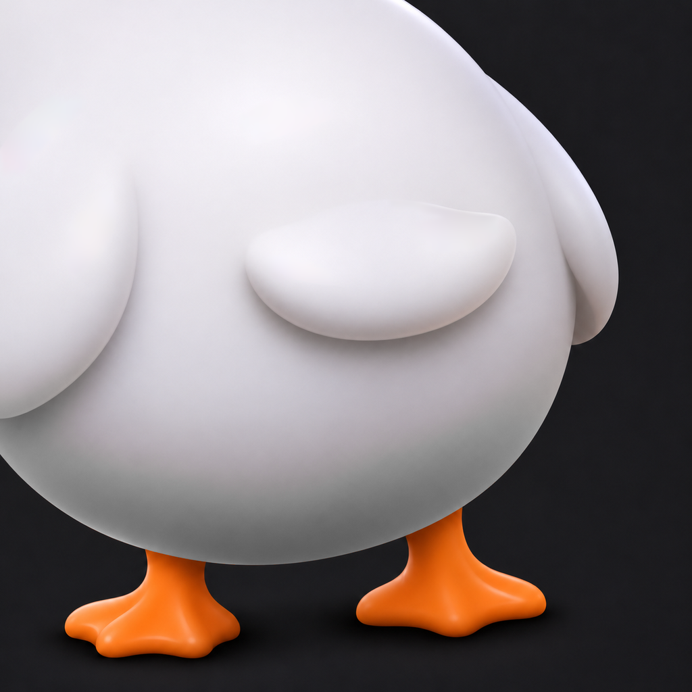
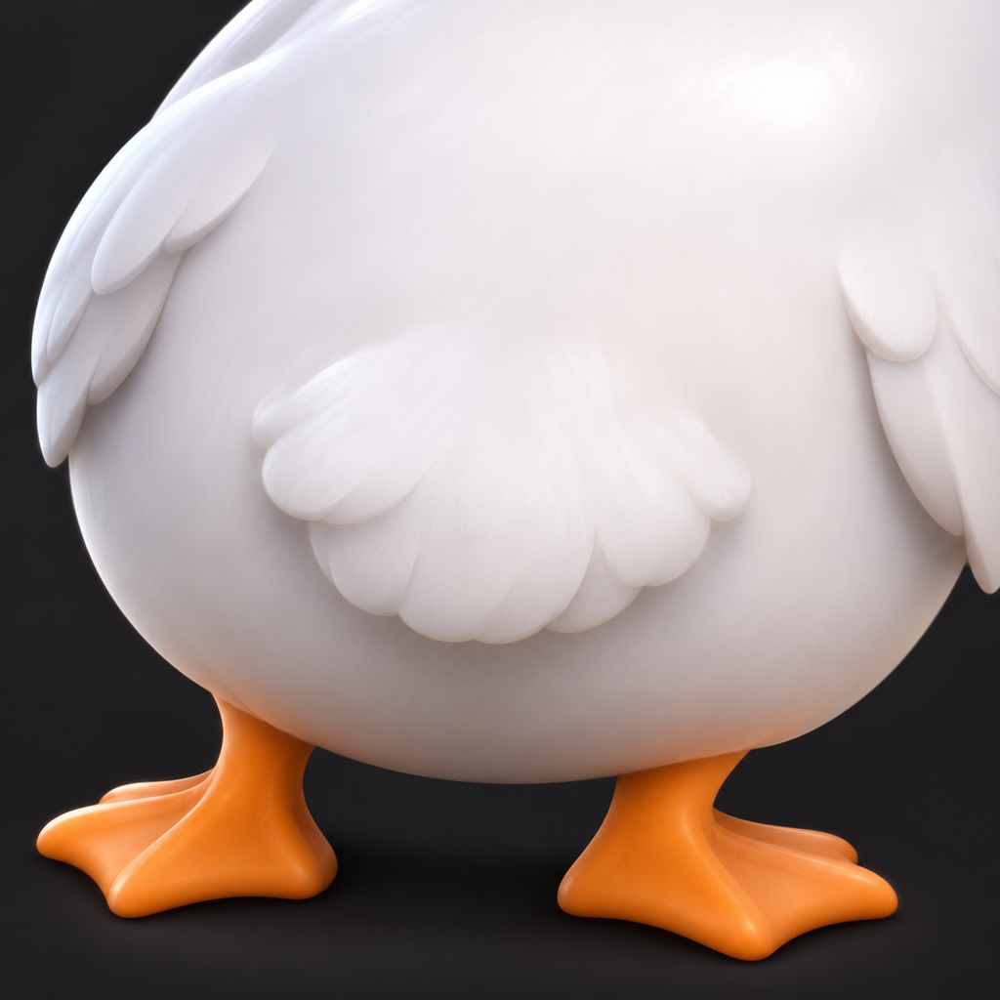
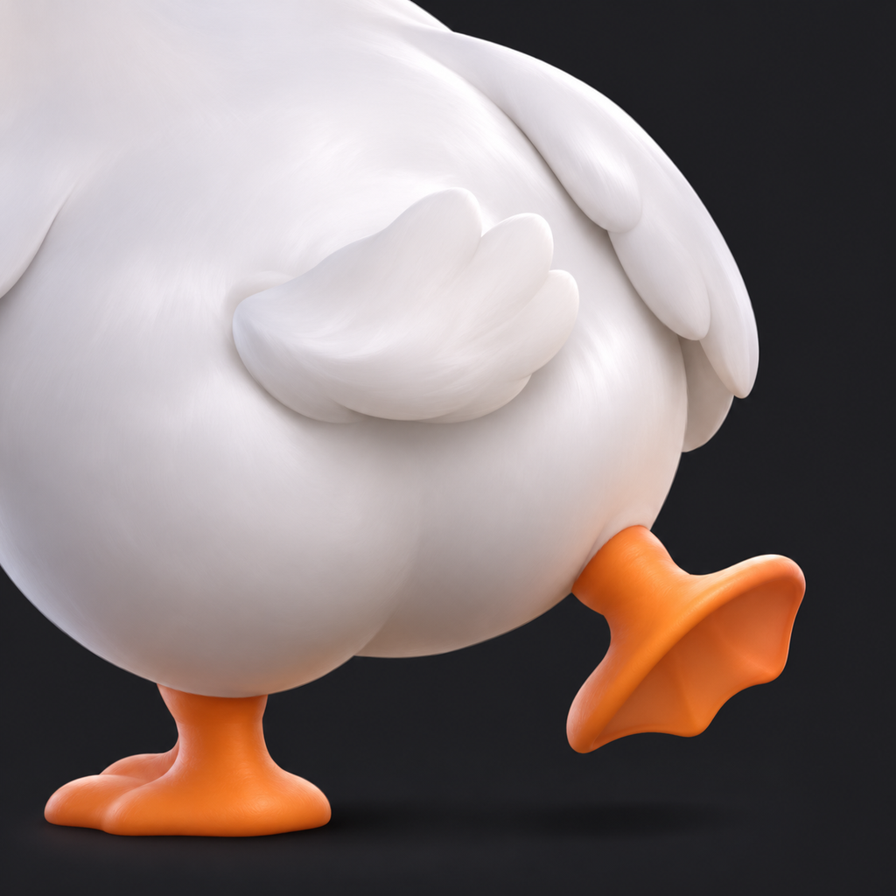
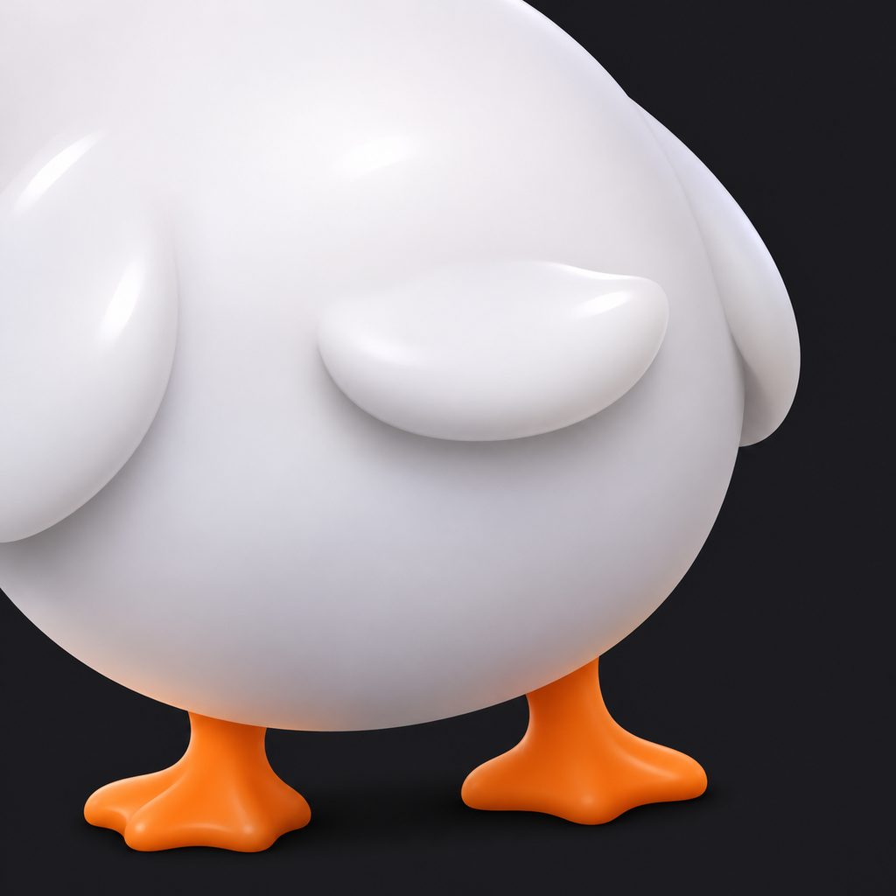

# Waddle app icon

As of 2026-11-04. The app is being rebranded as Waddle, after waddling geese and ducks. The rebrand hasn't started: the icon below is chosen but not yet wired into `apps/mobile`.

## Final icon

[`final-matte.png`](./waddle-app-icon/final-matte.png) is the agreed icon. It shows a cartoon goose's rear from the waist down, cropped so the upper body sits out of frame, on a dark charcoal tile. The style takes the Grok bot icon's soft shading and rounded, cartoony form, with a matte finish instead of a glossy one.

## Early candidates

These are the first-round options, kept as references for the shape and stance.

| A, feathered                                                    | B, mid-waddle                                                | C, smooth                                                   |
| --------------------------------------------------------------- | ------------------------------------------------------------ | ----------------------------------------------------------- |
|      |  |     |
| Feather texture and tail tuft; the shading the final icon kept. | One foot lifted mid-step. The lifted foot needed more work.  | Smooth sculpted form; the base the final icon was built on. |

## How the final icon was made

All four images were made with Codex's image generation. The final icon is candidate C, refined in three passes:

1. Gave it the warm-grey shadow under the belly from candidate A.
2. Removed an orange reflection from the feet onto the white body, leaving neutral grey shadow.
3. Removed the glossy, porcelain-like highlights, keeping the diffuse shading and the slightly brighter top.

The second and third passes were local colour corrections to the image, so the shape stayed the same.

## Using it in the app

Each file is a 1024×1024 square, opaque RGB PNG with no alpha channel, which is the single master size Xcode and Expo expect. Don't add rounded corners: iOS applies its own mask. When the rebrand starts, copy `final-matte.png` over `apps/mobile/assets/images/icon.png`, or point `ios.icon` in `apps/mobile/app.json` at it. Android's adaptive icon needs separate foreground and background layers, which haven't been made yet.

Replacing these images adds a new copy to git history each time, so commit icon changes only once they're agreed.
