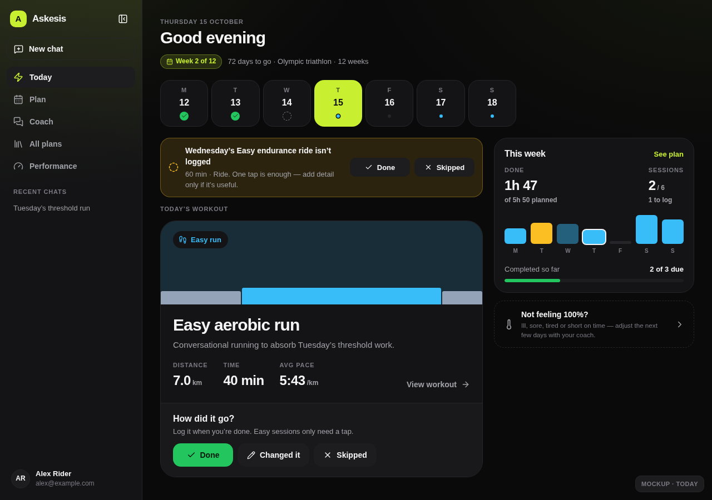
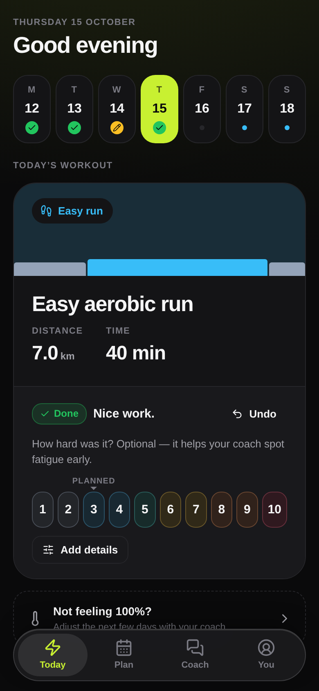
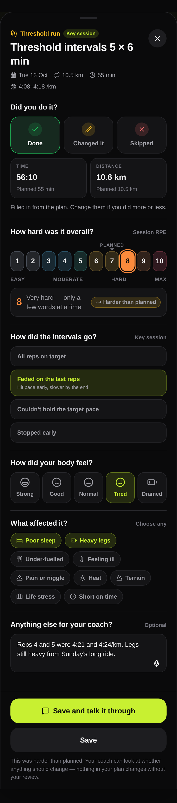
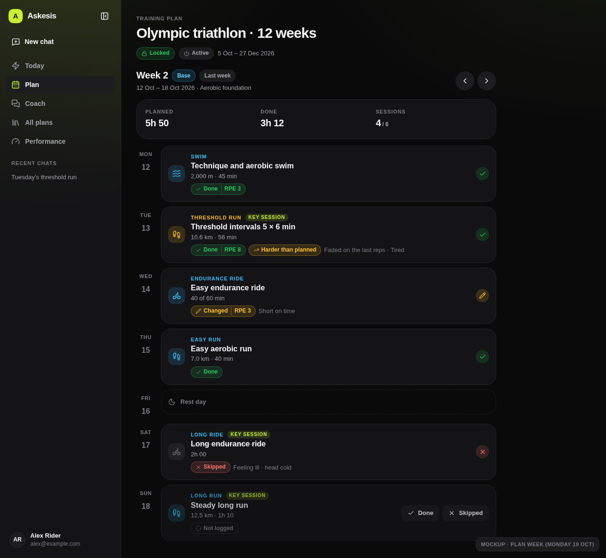
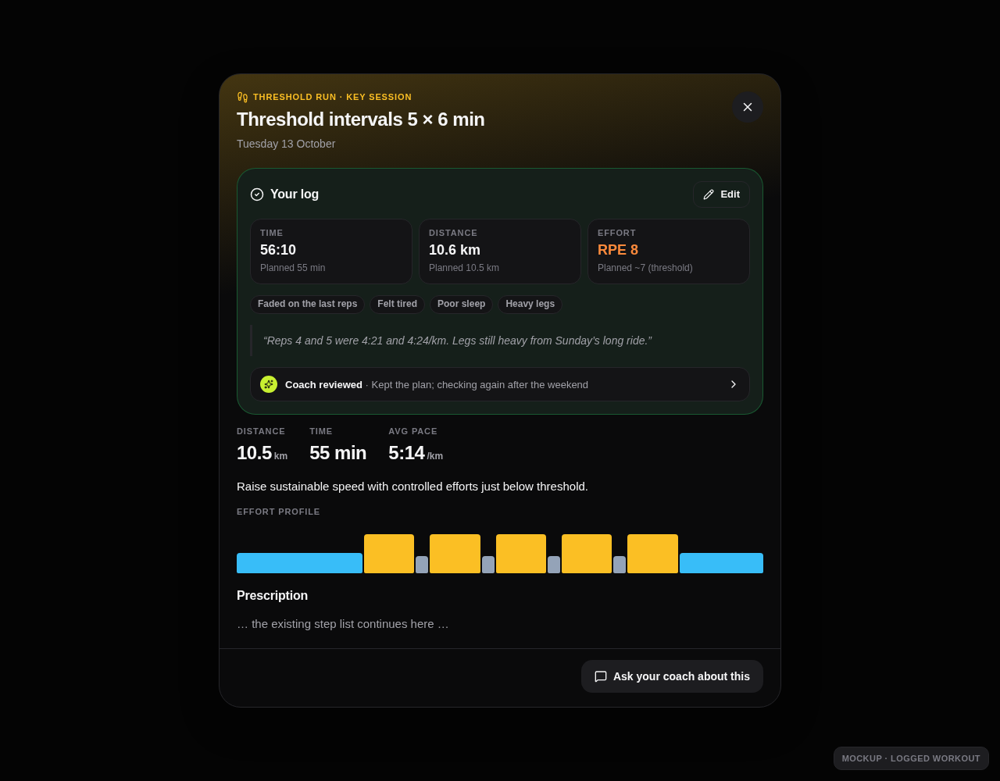
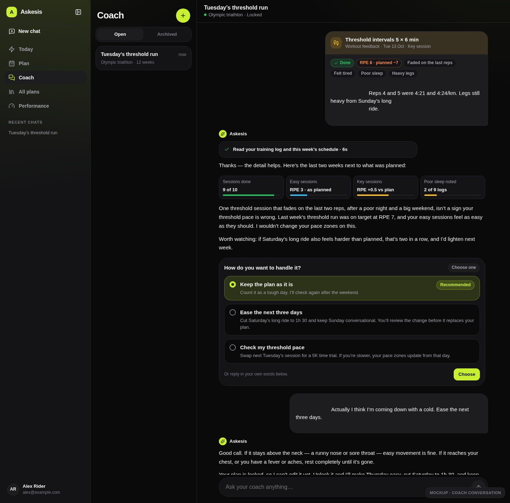
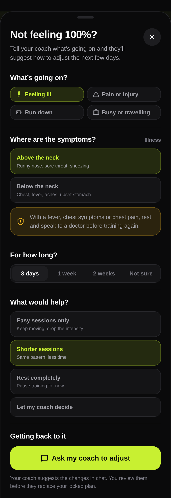

# Workout logging and feedback proposal

Status: **accepted for implementation**, updated 2026-10-14 following owner feedback. Manual slices 1–3 are now implemented; see the [feature contract and demo guide](./training-log.md). It scopes [#45](https://github.com/benjamingriff/askesis/issues/45) (completion and perceived-effort feedback) and provides a foundation for [#46](https://github.com/benjamingriff/askesis/issues/46) (weekly reviews). Strava/activity import ([#54](https://github.com/benjamingriff/askesis/issues/54)) is deferred and outside this implementation.

## Summary

Askesis can prescribe a plan but cannot yet tell what happened. This proposal adds a **training log**: a record per planned workout of whether it was done, changed or skipped, and how it felt. The log feeds the coach, which can then keep the plan, ease it, or suggest checking fitness. Plan changes still need human review and locking.

Recommendations:

1. **Logging should take one tap.** Every past workout asks “How did it go?” with **Done / Changed it / Skipped**. Easy sessions need nothing more; a 1–10 effort rating is optional.
2. **Key sessions ask for more.** Workouts marked as key sessions, plus races and tests, open a short feedback sheet. So do sessions logged as changed or skipped, or rated harder than planned. The questions depend on the workout type. Each one is something the coach can act on.
3. **The athlete owns the log; plan versions don't.** It sits alongside the plan's immutable versions, the same way athlete performance does ([ADR 0005](../adr/0005-athlete-owned-performance.md)). It is keyed by workout lineage, so it survives unlock/lock cycles.
4. **Feedback leads into a conversation, not automatic changes.** Saving feedback never calls the model. “Save and talk it through” opens a plan chat with the feedback attached as a structured card. The coach reads the log and proposes options. The existing unlock → draft → review → lock flow applies any change.
5. **Feeling alone never changes fitness numbers.** A hard session doesn't lower threshold pace and an easy one doesn't raise it. Repeated signals lead the coach to suggest a **test**, which goes through the existing `preview_performance` / `record_performance` flow. Logged test and race results go straight into that flow.
6. **Logs can be corrected without unlocking.** Create, edit or clear a log at any time while the plan is locked or unlocked. Only amendments to the prescribed plan require the existing unlock → draft → review → lock flow. Activity imports are deferred.

## What other training apps do

| App                | What they capture                                                                                                                                                                                                                                                                                                                    | How it changes the plan                                                                                                                                                    | What to take                                                                                                                                                                            |
| ------------------ | ------------------------------------------------------------------------------------------------------------------------------------------------------------------------------------------------------------------------------------------------------------------------------------------------------------------------------------ | -------------------------------------------------------------------------------------------------------------------------------------------------------------------------- | --------------------------------------------------------------------------------------------------------------------------------------------------------------------------------------- |
| **TrainerRoad**    | After each workout: “How did this effort feel?” on five levels (Easy, Moderate, Hard, Very hard, All out). Struggled or cut-short workouts get a second survey with reasons such as time, fatigue, under-fuelled, poor sleep, stress, sick, injured, equipment, heat or menstrual cycle. Answers can be added or changed for 7 days. | Adaptive Training combines the survey with power data to adjust upcoming workouts and FTP detection.                                                                       | Answering takes seconds. Follow-up questions appear only when something went wrong. Rate the whole session in absolute terms, not against expectations. Reasons come from a fixed list. |
| **TrainingPeaks**  | “How did you feel?” (five faces, Strong to Weak) and Perceived effort (1–10), plus post-activity comments. Compliance colours compare planned and completed duration, distance or TSS: green within ±20%, yellow 50–79% or 121–150%, orange beyond that, red not done, grey unplanned.                                               | A human coach reads the feedback. The app doesn't adapt the plan.                                                                                                          | Keep how the athlete felt separate from how hard the session was. Planned-versus-actual colours make a week easy to scan.                                                               |
| **Strava**         | A 1–10 Perceived Exertion slider with descriptions (1–3 Easy “could talk normally”, 4–6 Moderate, 7–9 Hard “could barely talk”, 10 Max). Without heart rate, RPE drives Relative Effort and Fitness.                                                                                                                                 | No plans.                                                                                                                                                                  | Descriptions under each RPE number make the ratings consistent. RPE × duration gives a training load without heart rate.                                                                |
| **Garmin Connect** | After an activity is saved, the watch asks for perceived effort and how you felt. It can be skipped and configured per activity type.                                                                                                                                                                                                | Feeds training status and load.                                                                                                                                            | Ask once and allow skipping. Show the questions only for relevant activity types.                                                                                                       |
| **Runna**          | Mainly measured pace from the device, plus notes and photos. A separate **Not Feeling 100%** tool records the reason (illness, aches, busy, need it easier), the duration (3–14 days), what to do (easy runs only, shorten, full break, drop strength) and how to return (slowly, balanced, quickly).                                | Pace targets change only after **repeated** missed or beaten targets on tempo and interval sessions; anomalies are ignored. Not Feeling 100% temporarily reduces training. | Act on patterns, not single sessions. Use a structured flow for “I’m ill or struggling”. Return to training gradually.                                                                  |

Sports science agrees. Session RPE (Foster), CR-10 RPE × minutes, is a validated, low-cost measure of internal training load for endurance athletes. Collect it 15–30 minutes after the session to reduce recency bias. That supports asking for RPE soon after a workout and computing weekly load from it ([review](https://pmc.ncbi.nlm.nih.gov/articles/PMC5673663/), [endurance application](https://pmc.ncbi.nlm.nih.gov/articles/PMC11155691/)).

Sources: [TrainerRoad post-workout surveys](https://support.trainerroad.com/hc/trainerroad-support/articles/4404884465563-what-are-post-workout-surveys), [TrainingPeaks subjective feedback](https://www.trainingpeaks.com/learn/articles/what-are-rpe-and-subjective-feedback/), [TrainingPeaks compliance](https://help.trainingpeaks.com/hc/en-us/articles/204861204), [Strava Perceived Exertion](https://support.strava.com/hc/en-us/articles/360032535512-Perceived-Exertion), [Garmin activity evaluation](https://www8.garmin.com/manuals/webhelp/GUID-2CD92989-7336-4BF3-96CC-50DDBD63B109/EN-US/GUID-75149D69-850F-4B21-80AF-825BDF3C3E6E.html), [Runna Not Feeling 100%](https://support.runna.com/en/articles/13531498-how-to-use-not-feeling-100), [How Runna adapts](https://the5krunner.com/2026/09/28/is-runna-ai/).

### What Askesis can do better

- **Show the expected effort.** The prescription already has zones and RPE targets, so the RPE scale can mark “Planned ~7”. “Harder than planned” is then calculated from the prescription, not guessed. TrainerRoad asks for an absolute rating and infers the expectation itself; we can show both.
- **Explain decisions in the conversation.** Other apps change workouts silently. Askesis's coach can say why, offer options and let the athlete choose. That suits the product's chat-first approach and its human-review rule.
- **Use one log for every sport.** Running, cycling, swimming and strength get the same Done / Changed / Skipped log. Only the follow-up questions vary.

## Experience

### Where logging appears

| Surface                              | Change                                                                                                                                                                                                                                                                                                |
| ------------------------------------ | ----------------------------------------------------------------------------------------------------------------------------------------------------------------------------------------------------------------------------------------------------------------------------------------------------- |
| **Today hero**                       | Once the workout date has arrived, a “How did it go?” bar sits under the hero card with **Done / Changed it / Skipped**. After **Done**, the bar shows an optional 1–10 effort row with the planned effort marked, plus **Add details** and **Undo**. Key sessions open the full sheet straight away. |
| **Today: earlier unlogged sessions** | A warning-tone notice above the hero lists unlogged workouts from the last 3 days, each with one-tap **Done / Skipped**. Older gaps are left alone so they don't build up into a backlog.                                                                                                             |
| **Week strip**                       | The kind dot becomes a status mark: green tick, amber pencil (changed), red cross (skipped) or a dashed ring (past and not logged). Future days keep the coloured dot.                                                                                                                                |
| **This week card**                   | “Done 1h 47 of 5h 50” and “Sessions 2 / 6, 1 to log”. Logged days show solid bars; unlogged past days stay dimmed as they are today.                                                                                                                                                                  |
| **Plan schedule**                    | Past workout cards show a status chip (with RPE), any “Harder/Easier than planned” flag and a short summary of the reasons. A status mark replaces the chevron. Skipped titles are struck through. A past, unlogged workout shows **Done / Skipped** inline.                                          |
| **Workout dialog**                   | A logged workout gets a **Your log** section with planned and actual time, distance and effort, the feedback, the note, and a link to any coach conversation about it. **Edit** reopens the sheet.                                                                                                    |
| **Coach chat**                       | “Save and talk it through” opens the plan's chat with a **Workout feedback** card as the user message. The coach replies with evidence and a set of choices (see below).                                                                                                                              |
| **Not feeling 100%**                 | An entry on Today and in the plan options menu opens a short structured sheet. It starts a coaching conversation about the next few days.                                                                                                                                                             |

### Mockups

Each mockup is a static HTML page built on the web app's own stylesheet, tokens and icons ([source](./workout-feedback-mockups/)). Open them directly in a browser, or re-render them with headless Chromium.

**Today on desktop.** The hero asks “How did it go?”, an earlier unlogged ride can be logged with one tap, and the week strip and This week card show progress.



**Phone after tapping Done on an easy run.** Effort is optional and shows the planned value.



**The key-session feedback sheet on a phone.** It asks for status and actuals, RPE against plan, an interval-specific question, how the body felt, contributing factors, and a note.



**A plan week after it has happened.** It shows Done, Done but harder than planned, Changed, Skipped (ill) and Not logged.



**Logged workout detail.**



**Talking it through with the coach.** The feedback appears as a structured card. The coach shows the evidence and offers choices. Applying a change needs a human unlock.



**Not feeling 100%.**



### Statuses

| Status         | Meaning                                                                                                             | Default actuals                                                 |
| -------------- | ------------------------------------------------------------------------------------------------------------------- | --------------------------------------------------------------- |
| **Done**       | Done roughly as prescribed.                                                                                         | Planned time and distance, editable.                            |
| **Changed it** | Did something different: shorter, longer, easier, a different session or a different day.                           | The athlete enters time and/or distance. A reason is asked for. |
| **Skipped**    | Didn't train.                                                                                                       | None. A reason is asked for (optional).                         |
| _(no log)_     | Future: planned. Past: **not logged**. That is not the same as skipped; the app never assumes a session was missed. | —                                                               |

Timing follows the athlete's timezone: a workout can be logged from its scheduled date onwards. An earlier date can't be logged as done; that is a schedule change for the coach. A log can be edited or cleared at any time. TrainerRoad's 7-day limit exists to protect its adaptation model; we don't need it.

A workout done on a different day is logged as **Done** with `performedOn` set to that day. The plan doesn't move. Reordering future sessions is a coaching conversation.

### When the full feedback sheet appears

The sheet opens automatically (it can be dismissed and filled in later) when **any** of these apply:

- the workout is a **key session** (`priority: high`, already shown as “Key session”);
- the workout is a **race** (`racePriority` A, B or C) or a **test** (fitness test, time trial, CSS or FTP test);
- the status is **Changed it** or **Skipped** (reasons only);
- the quick RPE is **2 or more points above** the planned effort, or **3 or more below** it.

Otherwise the quick log is all the athlete sees. Coaches already mark one to three sessions a week as key, so the full sheet appears two or three times a week. That reflects the owner's idea of “specific key workouts trigger feedback requests”.

### Question bank

All questions are optional except status. Answers use fixed values so the coach and deterministic summaries can use them; a free-text note is always available.

**Common to every log**

| Question                 | Answers                                                   | Why                                                           |
| ------------------------ | --------------------------------------------------------- | ------------------------------------------------------------- |
| Did you do it?           | Done / Changed it / Skipped                               | Adherence.                                                    |
| Time, distance           | Prefilled from the plan, editable                         | Planned versus actual volume, and Strava matching later.      |
| How hard was it overall? | Session RPE 1–10 with descriptions; planned effort marked | Internal load (RPE × minutes) and harder/easier than planned. |

**Full sheet additions**

| Question                      | Answers                                                                                                                         | Shown when                                                                |
| ----------------------------- | ------------------------------------------------------------------------------------------------------------------------------- | ------------------------------------------------------------------------- |
| How did your body feel?       | Strong / Good / Normal / Tired / Drained                                                                                        | Always on the full sheet (TrainingPeaks-style “feel”, separate from RPE). |
| What affected it?             | Poor sleep, Heavy legs, Under-fuelled, Feeling ill, Pain or niggle, Heat, Terrain, Life stress, Short on time, Equipment, Other | Changed, Skipped, or RPE outside the expected range.                      |
| Where is the pain? How bad?   | Body area list + “Mild, didn't change my stride / Changed how I moved / Had to stop”                                            | “Pain or niggle” selected.                                                |
| Anything else for your coach? | Free text (2,000 characters); dictation later (#50)                                                                             | Always.                                                                   |

**Type-specific follow-ups.** The type comes from the workout (see [prerequisite](#prerequisite-explicit-session-type)):

| Session type                    | Question                  | Answers                                                                                | What the coach does with it                                                                                                                          |
| ------------------------------- | ------------------------- | -------------------------------------------------------------------------------------- | ---------------------------------------------------------------------------------------------------------------------------------------------------- |
| Intervals / threshold / tempo   | How did the intervals go? | All reps on target / Faded on the last reps / Couldn't hold the target / Stopped early | Repeated misses with high RPE suggest zones may be set too high, so suggest a test. Repeatedly on target with low RPE suggests a test to raise them. |
| Long run / ride / swim          | How did you finish?       | Strong / Faded late / Struggled throughout; Fuelled? Yes / Some / No                   | A late fade with no fuelling is a fuelling conversation, not a load change.                                                                          |
| Strength                        | Were the weights right?   | Too light / About right / Too heavy; optional weight used per lift                     | Adjust suggested load (kg) in future sessions. RIR governs effort, per the [multisport decisions](../adr/0006-multisport-plans.md).                  |
| Brick / Hyrox                   | Which part was hardest?   | List of the session's sports and stations                                              | Shift emphasis in future sessions.                                                                                                                   |
| Test (FTP, CSS, 5K, time trial) | Your result               | The same inputs the Performance page uses for that system                              | Go straight to the existing `preview_performance`. Recording follows the coach's current rules (all-out? fair conditions?).                          |
| Race                            | Result and how it went    | Finish time; Went to plan / Faded / Better than expected; free text                    | Race results go through `preview_performance` for running. A race starts recovery and the next block.                                                |

### Not feeling 100%

This follows Runna's structure, routed through the coach:

1. **What's going on?** Feeling ill / Pain or injury / Run down / Busy or travelling.
2. Follow-up depending on the answer. Illness: above or below the neck. Pain: where, and how bad.
3. **For how long?** 3 days / 1 week / 2 weeks / Not sure.
4. **What would help?** Easy sessions only / Shorter sessions / Rest completely / Let my coach decide.
5. **Getting back to it:** Gently / Balanced / Quickly.

The sheet lists the key sessions inside the window. **Ask my coach to adjust** opens the plan chat with these answers as a structured card. The coach proposes the change and the athlete unlocks the plan to apply it.

**Safety.** Fever, chest symptoms, chest pain, or pain that changes how someone moves prompt rest and advice to see a professional. The coach doesn't plan training through those. The prompt states this rule; the UI shows it as a notice, not a diagnosis.

## How the coach should respond

The aim is the behaviour the owner described: sometimes accept a hard session and move on, sometimes ease off, sometimes change threshold pace, and say which and why. Rules for the prompt, supported by deterministic summaries the API calculates:

| Signal (from `read_training_log`)                                                               | Default response                                                                                                                                     |
| ----------------------------------------------------------------------------------------------- | ---------------------------------------------------------------------------------------------------------------------------------------------------- |
| One key session rated harder than planned, with explanatory factors (sleep, heat, earlier load) | **Accept and move on.** Name the likely cause. Say what would change the assessment, e.g. “if Saturday is also hard”.                                |
| Two or more of the last three key sessions harder than planned, or faded/missed targets         | **Offer to ease off:** lighter next few days, move the cutback week earlier, or reduce intensity. Ask before planning a test.                        |
| Easy sessions repeatedly rated 5 or more, or “Tired/Drained” on most recent logs                | **Fatigue:** suggest an earlier cutback, slower easy sessions, and ask about sleep and stress. Don't change zones.                                   |
| Key sessions repeatedly rated 2 or more below plan with all reps on target                      | **Suggest a test** to raise zones: a 5K or threshold run, 20-minute or ramp test, or CSS test. Never raise zones from feel alone.                    |
| Logged test or race result                                                                      | **Use the existing performance flow:** preview against the current entry, record it if it's as good or better, otherwise ask about conditions first. |
| Skipped one session                                                                             | Don't make it up. Continue the plan.                                                                                                                 |
| Two or more key sessions skipped in a week, or 5 or more days missed                            | **Rebuild:** propose a shorter return block before resuming progression. Long breaks may need a test.                                                |
| Illness or injury (log reasons or Not feeling 100%)                                             | Follow the safety rule. Reduce or rest over the stated window. Use the chosen return style.                                                          |
| Changed: consistently shortened for lack of time                                                | A logistics problem, not a fitness one. Offer to move volume to days that have time, or shorten the plan's sessions.                                 |

The coach should state the evidence in the reply (the mockup's compact evidence row). It should offer two or three options, recommending one, as a structured choice. That needs the structured-question work in [#39](https://github.com/benjamingriff/askesis/issues/39); until then, a markdown list with a recommendation works. Locked plans still need unlocking, and the agent cannot unlock ([product constraints](../current-handoff.md)). The reply says what will change and asks the athlete to unlock. An **Unlock** call to action, like the mobile prototype's `action: 'unlock'` message part, opens the existing confirmation dialog.

## Domain model

### Why the log is separate from plan versions

- Locked versions are immutable and hashed. Recording what happened isn't a plan edit and mustn't create a version or prompt a review.
- **Workout lineage** already identifies “the same workout” across draft, lock, unlock and restore (`workouts.lineage_id`, retained by the schedule tools and used by change badges). A log keyed by `(plan_id, workout_lineage_id)` stays attached as versions change.
- Some workout fields are snapshotted at log time, so the log keeps its meaning if a later version moves or removes the workout.

“Completion” already means a step's end condition (`step_completions`), so this feature uses **log** and **logged** throughout to avoid confusion.

### Tables (sketch)

```sql
CREATE TABLE workout_logs (
  id uuid PRIMARY KEY DEFAULT gen_random_uuid(),
  athlete_id uuid NOT NULL REFERENCES athletes(id),
  plan_id uuid NOT NULL REFERENCES plans(id),
  workout_lineage_id uuid NOT NULL,
  logged_version_id uuid NOT NULL REFERENCES plan_versions(id), -- version shown when logged
  -- Snapshot so history stays readable after later edits
  scheduled_on date NOT NULL,
  title text NOT NULL,
  discipline text NOT NULL,
  session_type text,                                  -- see prerequisite
  key_session boolean NOT NULL,
  planned_duration_seconds integer,
  planned_distance_metres numeric(12,3),
  planned_rpe numeric(3,1),                           -- derived from the prescription
  -- What happened
  status text NOT NULL CHECK (status IN ('done','changed','skipped')),
  performed_on date NOT NULL,
  actual_duration_seconds integer CHECK (actual_duration_seconds > 0),
  actual_distance_metres numeric(12,3) CHECK (actual_distance_metres > 0),
  rpe smallint CHECK (rpe BETWEEN 1 AND 10),
  feel smallint CHECK (feel BETWEEN 1 AND 5),
  reasons text[] NOT NULL DEFAULT '{}',               -- validated against a fixed list
  answers jsonb CHECK (answers IS NULL OR jsonb_typeof(answers) = 'object'), -- type-specific, versioned schema
  answers_schema_version integer,
  note text CHECK (length(note) <= 2000),
  source text NOT NULL DEFAULT 'manual' CHECK (source IN ('manual','coach','import')),
  recorded_by_run_id uuid REFERENCES agent_runs(id),  -- the coach logged it from chat
  created_at timestamptz NOT NULL DEFAULT now(),
  updated_at timestamptz NOT NULL DEFAULT now(),
  UNIQUE (plan_id, workout_lineage_id),
  CHECK (status <> 'skipped' OR (actual_duration_seconds IS NULL AND actual_distance_metres IS NULL AND rpe IS NULL))
);
CREATE INDEX workout_logs_athlete_date_idx ON workout_logs (athlete_id, performed_on);

-- Short check-ins that aren't tied to one workout (Not feeling 100%).
CREATE TABLE athlete_check_ins (
  id uuid PRIMARY KEY DEFAULT gen_random_uuid(),
  athlete_id uuid NOT NULL REFERENCES athletes(id),
  plan_id uuid REFERENCES plans(id),
  kind text NOT NULL CHECK (kind IN ('ill','pain','run_down','busy')),
  details jsonb NOT NULL,                              -- symptoms, area, severity, preferences
  starts_on date NOT NULL,
  ends_on date,
  conversation_id uuid REFERENCES conversations(id),
  created_at timestamptz NOT NULL DEFAULT now()
);
```

Notes:

- **One log per planned workout.** Unplanned activities (an extra run, a Strava ride with no matching workout) need a nullable lineage and their own snapshot. They're deferred until import exists, but the table can allow them later.
- **Mutable, not append-only.** Unlike calibration, a log is the athlete's own account and can be edited or cleared. `updated_at` is enough for v1. Coaching runs record the log version they read, so a reply can say “based on your log at the time”.
- **Fixed lists live in code** (Zod enums in the API) with a schema version. They aren't in the database so they can change without migrations.
- **`planned_rpe`** comes from the prescription: an explicit RPE target if there is one, otherwise a duration-weighted mapping from zone to RPE per system (e.g. run easy → 3, threshold → 7, interval → 8–9). Use explicit RPE before zone mapping on each effort step. Recursively multiply weights through repeats; use duration completions in seconds, or distance divided by calibrated target speed (a documented sport-specific estimate when no pace is available). For untimed strength/repetition steps use an estimated three seconds per repetition, and for otherwise untimed efforts a one-minute estimate. RIR alone does not invent a precise RPE. Exclude unknown-intensity steps; return null if none have a known effort. Round the weighted mean to one decimal and label it approximate. The same server-side helper feeds summaries and saved snapshots. Missing actual duration or RPE means unknown load, not zero load.

### Interaction with plan editing

- **Amend upcoming training only.** When revising an existing plan, the coach preserves workouts before today in the athlete's timezone, whether logged or not, and today's already logged workouts. It changes only today's remaining sessions and future sessions. State this explicitly in the coaching prompt; the current prompt says to preserve “past revisions”, but does not explicitly prohibit rewriting past workout dates. Initial plan creation may still include historical dates. No new schedule-tool date guard is included in this feature.
- **Why range replacement came up.** `replace_schedule_range` deletes and recreates every workout in its range (`agent.schedule.ts`), giving them new lineages. With logging restricted to due workouts, a replacement confined to future dates cannot detach any logs. The risk is a replacement that accidentally includes past or already logged sessions. The prompt should scope the replacement to upcoming training and reuse existing weeks/blocks spanning that boundary. Logs retain their snapshots if a workout is removed by a restore or an erroneous edit; past-workout enforcement across schedule tools is a possible separate reliability improvement.
- **Unlock, lock and restore** keep lineage IDs, so logs stay attached. Restoring an old version that predates a logged workout leaves the log as an “unplanned” entry, shown with its snapshot.
- **Hashes and review are unaffected.** Logs aren't plan content: version hashes, review diffs and lock rules don't change.
- **Archive** keeps logs read-only.
- **Which plans can be logged.** Only plans with a locked version, which is what Today shows. While a plan is unlocked, its locked pointer stays in place (`unlockPlanRows`), so logging continues against the locked schedule and the lineages carry over into the draft. Draft-only plans have nothing to log.
- **Several active plans.** Logs belong to a plan, but the coach's summary is athlete-wide. A strength plan's sessions count towards fatigue when a running plan is discussed.

### Prerequisite: explicit session type

The web currently guesses kind (easy, long, tempo, intervals, test, race) from titles (`inferKind`; a known gap in the [design system](./web-design-system.md#known-gaps)). Type-specific questions and coaching rules need a real value. Add an optional `sessionType` to workouts, set by the schedule tools and shown in the API. The title-based guess stays as a fallback for workouts without one. Including it in the canonical hash bumps `CONTENT_HASH_VERSION` from 7 to 8; `content_schema_version` remains 4 because the field is additive and nullable. Existing locked hashes are not rewritten; null-valued historical workouts remain restorable.

## API, live updates and coaching tools

**Public API** (owner-scoped, idempotent like the other commands):

- `GET /api/v1/training-log?planId=&from=&to=` returns the logs and a weekly summary: planned and done minutes and distance per sport, sessions due/done/changed/skipped/unlogged, session load (RPE × minutes), and key-session RPE versus planned.
- `PUT /api/v1/plans/{planId}/workouts/{lineageId}/log` creates or replaces a log. Creation validates that the lineage exists in the current locked version, that the date is not in the future, and the type-specific `answers`. Updates to an existing owned log use its original snapshot and provenance even if a restore/relock removed that lineage from the current schedule; clearing has the same eligibility. The Plan schedule includes a training-log history dialog listing saved entries (including detached entries), with edit/clear and conversation actions. Archived plans remain read-only.
- `DELETE /api/v1/plans/{planId}/workouts/{lineageId}/log` clears a log.
- `POST /api/v1/check-ins` creates a check-in and returns the structured message for the conversation.
- `WorkoutSummary` gains `lineageId` and `plannedRpe`. The web joins logs to workouts by lineage, so workout queries stay cacheable per version.
- Live journal: `training_log.changed { planId, lineageIds }`, refetched like `performance.changed`.

**Coaching worker tools** (API-authorized, like the existing domain tools):

- `read_training_log({ from, to })` returns the athlete's logs across their plans plus the same deterministic summary and the flags behind the [response table](#how-the-coach-should-respond): consecutive harder-than-planned key sessions, recent skip count, fatigue signals. The model reads calculated facts and doesn't compute them.
- `record_workout_log(...)` lets the coach log what the athlete says in chat (“did today's run, felt awful”), with `source = 'coach'`. It never invents a log, and it confirms what it recorded.
- The plan context includes a short summary of the last 14 days, so ordinary chats know recent training without an extra call.

**Prompt changes.** Explicitly require amendments to preserve past workouts and today's logged workouts, and use scoped upcoming ranges. This is separate from initial generation of a plan with historical start dates. Replace “Do not claim wearable ingestion, completed workouts…” with log-aware guidance: the response table, the safety rule, “never change zones from feel; propose a test”, and “state evidence and offer options, recommend one”. The training-plan benchmarks ([proposal](./training-plan-benchmarks-proposal.md)) can add scenarios with seeded logs to check that behaviour.

**The feedback conversation.** “Save and talk it through” sends a user message with a typed `workout_feedback` part: the log ID and a display snapshot. It is rendered as the card in the mockup and resolved through the API when the run starts, following the workout-reference design in [#38](https://github.com/benjamingriff/askesis/issues/38). Messages currently hold only text plus a version `context` (`conversation_messages`), so this needs a small extension: a nullable, validated `references` JSON array on user messages (initially `{ type: 'workout_log', logId }` and `{ type: 'check_in', checkInId }`). The [#38](https://github.com/benjamingriff/askesis/issues/38) workout references can reuse it. The message text keeps a readable summary, so older clients and the model transcript still make sense. References are owner-checked and associated with the conversation plan on send. The server persists a display snapshot at send time. When a coaching run reads context, it resolves the current owned log/check-in alongside that snapshot and explicitly marks changed or cleared logs, without losing the original message. Carry references and training summaries through `apps/agent/src/api.ts` and `runtime.ts` to the model. Any model call starts only when the athlete chooses to talk. Saving feedback costs nothing.

## Deferred activity integration

Strava and other activity imports are outside the accepted implementation scope. Keep workout lineage and the planned-versus-actual log fields useful for a later integration, but do not implement OAuth, matching, webhooks, imported activities or a terms review now.

## Privacy

Logs and check-ins hold health information: illness, pain, sleep and how someone felt. They are owner-only like the rest of the athlete's data, are never shown to anyone else, and are sent to the model provider only as part of that athlete's coaching runs, as plan content already is. The Phase 8 privacy and data-removal procedures must include both tables. The fixed reason list leaves out anything more sensitive than training needs (for example, no menstrual-cycle option in v1). Adding one is an owner decision.

## Delivery slices

The [delivery preference](../current-handoff.md) is one complete PR per feature. These are the natural boundaries if the owner wants to split or reorder:

1. **Training log (manual):** migration, API, live event, `lineageId`/`plannedRpe` in workout summaries, Today hero bar, week strip, This week card, schedule chips and quick log, workout dialog “Your log”, full sheet with common questions. Logging, editing and clearing work while locked or unlocked and never change plan content. Include explicit session type so feedback selection is reliable from the first release. Add the upcoming-only amendment guidance to the coaching prompt. Coach tools `read_training_log` and `record_workout_log`, the 14-day summary in context, and the prompt rules.
2. **Type-specific questions and results:** follow-up questions by explicit session type; test and race results going straight to the performance preview. The `sessionType` field in tools, API and hash belongs with slice 1.
3. **Feedback conversation and Not feeling 100%:** message `references`, structured feedback card and check-ins in chat; the coach's evidence row; Unlock call to action. This uses #39 structured choices if that has shipped, otherwise prose.
4. **Weekly review (#46)** built on the log summary.
5. **Strava (#54)** as separately scoped future work.

Slices 1–3 are useful without any integration and match “for now, a simple way of recording whether a workout's completed”.

## Validation

- API and database tests: lineage stays attached through unlock → edit → lock → restore. Future-only range replacement leaves existing historical log associations intact. Editing or clearing a log works while locked and does not change the version hash or lock state. Restore an older revision and relock, then read, edit and clear a detached log from history. Snapshots and original prescription provenance remain unchanged on correction. Owner isolation. Future-date rejection. Skipped logs carry no actuals. Idempotent PUT.
- Deterministic summary tests: planned versus done volume per sport, session load, and harder-than-planned flags from zone-derived planned RPE across run, cycle and swim, including mixed sessions.
- Web component tests: each status on Today, strip, schedule and dialog. Quick log → undo. Full sheet appears for the trigger cases only. Live refetch after logging from another tab.
- Agent evaluations (benchmarks): one hard session gets accept-and-move-on. A pattern gets an offer to ease off. Repeated easy ratings get a test suggestion, not a zone change. Illness below the neck gets rest. No unlock attempt. Existing-plan amendments preserve past and already logged sessions, including when replacing a range spanning the current week; initial generation can still cover historical dates.
- Browser verification on desktop and phone widths with the example plans, per [local browser verification](../operations/local-development.md#agent-browser-verification-in-a-worktree).

## Accepted owner decisions (2026-10-14)

The owner accepted the proposal and UI mockups except where clarified below:

- Done / Changed it / Skipped; described RPE 1–10 with planned effort marked; separate body-feel question; selective full-sheet triggers; opt-in “Save and talk it through”.
- Logs attach by workout lineage and can be created, edited or cleared without unlocking the plan. Feedback can lead to a conversation; changing the plan still requires the existing human review lifecycle.
- When amending an existing plan, the coach changes upcoming training and preserves previous workouts. Make this explicit in the prompt. Additional schedule-tool enforcement is a possible separate piece of work, outside this feature.
- Strava is deferred; no integration or terms-review work in this implementation.
- Keep menstrual-cycle reasons out of v1, as proposed.
- Include explicit session type with the manual log foundation as an implementation sequencing choice. This avoids relying on workout titles for the accepted follow-up questions.

There are no outstanding product decisions blocking implementation. “Upcoming” means today’s unlogged sessions and future dates in the athlete’s timezone; already logged sessions today remain history. This is a documented implementation default that the owner can refine.

## Technical proposal review, revision 2

Independent round 1 requested RP-B01: edits after restore/relock must not require current-schedule membership. Resolved above with existing-log snapshot eligibility and a Plan training-log history dialog. RP-A01 clarifies hash/schema compatibility; RP-A02 covers worker serialization, reference ownership/snapshots and lifetime; RP-A03 specifies effort precedence, weighting and missing-load semantics. These clarify delivery of the accepted product behavior; no new owner decision is required.
